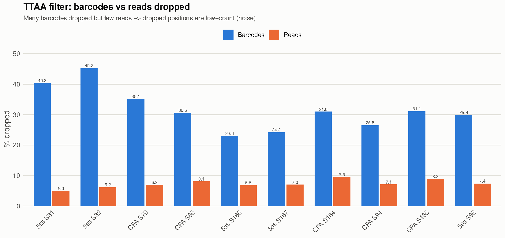
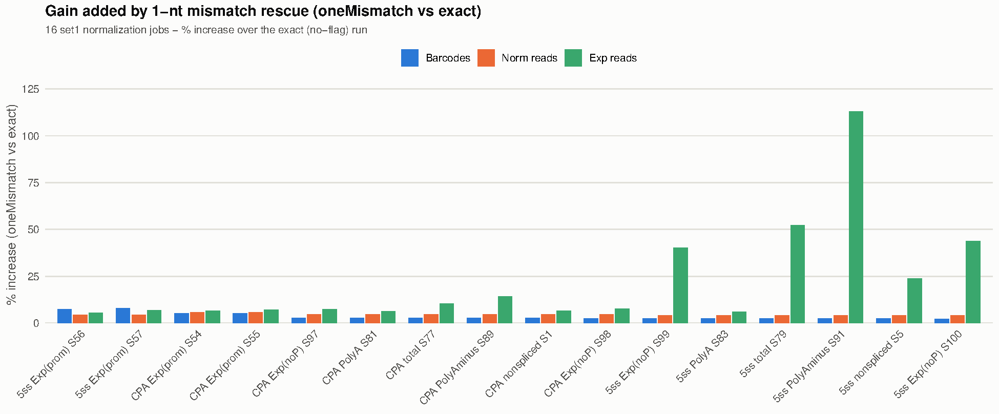
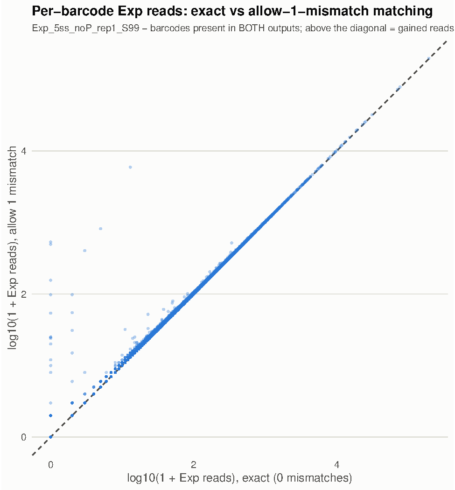
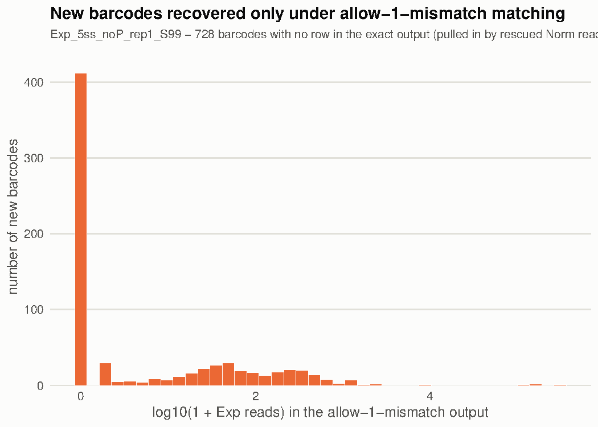
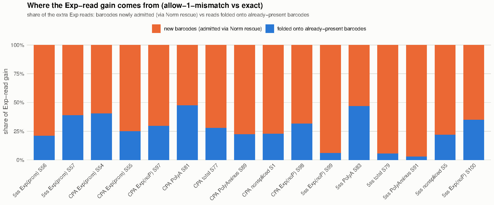

# Lab Notebook

> **Condensed English version** of the working lab notebook kept with this project. It carries the
> goals, the design decisions and their rationale, the measured results and the caveats — but not the
> line-level implementation detail (coordinate arithmetic, source-line references, raw toy-test
> inputs, case-by-case walkthroughs). For those, see the lab journal in Google Slides.
>
> Two naming notes: paths point at the lab file system (`/home/projects/ulitsky/...`), and the two new
> stages are referred to by their original workspace names —
> `NewScripts/filterMappings_TTAA/filterMappings_TTAA.R` is stage 04 of this repository
> (`scripts/04_filterMappings_TTAA.R`) and `NewScripts/normalizeTRIP_MM/normalizeTRIP_v2_MM.R` is
> stage 07 (`scripts/07_normalizeTRIP_v2_MM.R`). The figures are in [figures/](figures/).

## 26 July 2026 — Stage 3: TTAA filter in `filterMappings` (the piggyBac site)

**Goal:** at stage 3, keep only barcodes whose integration sits in a **TTAA** — the target site of the
piggyBac transposase.
**Status:** done in a separate copy, the original untouched. Run on a toy dataset — every case passes.

### What was created (everything in `NewScripts/filterMappings_TTAA/`)

| File | What |
|---|---|
| `filterMappings_TTAA.R` | a copy of `filterMappings.R` + an **optional** TTAA filter (new blocks marked `NEW BLOCK`) |
| `hg38_ttaa.bed` | a copy of the TTAA reference (627 MB, 19,784,878 sites) |
| `toy_test/` | toy dataset + driver `run_toy_test.sh` + `summarize.R` |

### The rule

The integration position recorded upstream by `analyzeTRIPMapping` is compared against the expected
TTAA coordinate, which sits at a **strand-dependent offset** from it. The test is an **exact** match
against the TTAA reference — no window, so a position shifted by even 1 bp is dropped. TTAA is its own
reverse complement, so a `+`-strand-only reference is complete and nothing has to be
reverse-complemented.

> The offset itself, why it is asymmetric between the strands, and the worked examples are in the lab
> journal in Google Slides.

### Interface (the flag is optional)

```
without the filter (as the original):  Rscript filterMappings_TTAA.R <path> <name>
with the filter:                       Rscript filterMappings_TTAA.R <path> <name> ttaaFilter <ttaa_bed>
```

Without the `ttaaFilter` flag the behaviour is **identical** to the original.

### Toy test (`toy_test/`, 12 positions, every case)

Two runs (baseline vs filtered), the result checked against a hand-written oracle → **ALL PASS**:

| # | case | baseline | filtered |
|---|---|---|---|
| 1 | `+` on a TTAA | keep | **keep** |
| 2 | `+` not a TTAA | keep | drop |
| 3 | `-` on a TTAA | keep | **keep** |
| 4 | `-` not a TTAA | keep | drop |
| 5 | `+`, TTAA on the WRONG side (the `-` window) | keep | drop |
| 6 | `+`, shifted by 1 (tests the exact match) | keep | drop |
| 7 | a contig with no TTAA at all | keep | drop (+WARNING) |
| 8 | contig edge (must not crash) | keep | drop |
| 9a| strong, on a TTAA | keep | **keep** |
| 9b| weak near-duplicate next to it | drop (proximity) | drop |
| 10a| **artefact barcode** (not on a TTAA) | keep | drop |
| 10b| weak **genuine** TTAA next to 10a | drop (proximity) | **keep (RESCUE)** |

Baseline kept 10/12, the TTAA filter kept 4/12. Three of the cases are deliberate traps — a TTAA
present but on the wrong strand, an off-by-one TTAA, and a position that the *proximity* filter (not
the TTAA one) removes; the per-case coordinates are worked through in the lab journal.

To run it and eyeball the two outputs (`RESULT_without_ttaa.bed` vs `RESULT_with_ttaa.bed`):
`bash NewScripts/filterMappings_TTAA/toy_test/run_toy_test.sh`.

### The star case 10a/10b (why the insertion point matters)

Two positions 5 bp apart, with barcodes differing by one letter:

| position | count | on a TTAA? | what it is |
|---|---|---|---|
| **CASE10A** | 100 (strong) | **no** | an **artefact barcode** — a mapping error, not a real piggyBac integration |
| **CASE10B** | 20 (weak) | **yes** | a real TTAA integration |

The old proximity filter treats a weak position next to a nearly identical strong one as its "echo"
and drops the weak one; strong positions are processed first and become the anchors everything else is
compared against.

- **Without the TTAA filter:** the strong artefact is processed first, survives, becomes an anchor, and
  the weak genuine position next to it is dropped as an echo. The artefact stays, the real
  integration is lost.
- **With the TTAA filter:** the artefact is not on a TTAA, so it is dropped immediately and never
  becomes an anchor; nothing suppresses the genuine position and it survives.

This only works because the TTAA check runs **before** the proximity block — early enough that a
non-TTAA position cannot become an anchor. Put it later and the artefact would crush the real position
before being removed itself.

Losing the artefact's counts (100 reads here) is intended: piggyBac always lands in a TTAA, so a
non-TTAA position is not a real integration and its counts are artefactual. Still, it is real data
loss, which is why it had to be measured on real libraries (next entry).

### Open questions

- **The `analyzeTRIPMapping` version** matters: the two variants in the lab differ by 1 bp in how they
  record the minus-strand position, which shifts the expected TTAA coordinate. Confirm which one
  produced the target tables before running on real data.

---

## 26 July 2026 — Stage 3 TTAA filter: analysis on real data (10 Map libraries, LSF)

> Continuation of the entry above.

**Goal:** measure how much data the TTAA filter actually loses. `filterMappings_TTAA.R` was run on
**10 real Map libraries** (run3 + run5) in **two modes** — baseline (no flag, = the original) and with
`ttaaFilter` — i.e. 20 jobs. From each log we took the input positions and reads, how many the ordinary
proximity filter dropped, and how many the TTAA filter dropped. The harness and results are in
`NewScripts/filterMappings_TTAA/analysis/` (full numbers in its `summary.csv`).

### Per library (what TTAA specifically drops)

| Library | Input positions | % barcodes dropped by TTAA | % reads dropped by TTAA |
|---|---:|---:|---:|
| 5ss S81  | 10,419  | 40.3 % | 5.0 % |
| 5ss S82  | 14,348  | 45.2 % | 6.2 % |
| CPA S79  | 19,208  | 35.1 % | 6.9 % |
| CPA S80  | 20,653  | 30.6 % | 8.1 % |
| 5ss S166 | 62,754  | 23.0 % | 6.8 % |
| 5ss S167 | 66,383  | 24.2 % | 7.0 % |
| CPA S164 | 84,947  | 31.0 % | 9.5 % |
| CPA S165 | 93,737  | 31.1 % | 8.8 % |
| 5ss S96  | 105,484 | 29.9 % | 7.4 % |
| CPA S94  | 90,754  | 26.5 % | 7.1 % |

### Headline result (whole pool: 568,687 positions, ~27.9 M reads)

| Filter | Barcodes dropped | Reads dropped |
|---|---:|---:|
| ordinary (proximity) | ~29,011 (**5.1 %**) | ~110,436 (**0.4 %**) |
| **TTAA** | ~165,176 (**29.0 %**) | ~2,124,705 (**7.6 %**) |

**Conclusion:** the TTAA filter drops ~**29 % of barcodes** but only ~**7.6 % of reads** — the discarded
positions are predominantly low-frequency ones, i.e. the expected noise and mapping artefacts rather
than signal. Exactly the behaviour the filter was built for (see the star case above).

**Figure 1** — % of dropped barcodes and reads per library:


**Figure 2** — TTAA: barcodes vs reads:



**Figure 3** — pool totals:


### Correctness checks (all passed)

- **The coordinate offset is right.** Checked directly against the genome: our offset puts **64–77 %**
  of the kept positions on a TTAA, whereas ±1 bp shifts give **<6 %** — so it was chosen correctly, not
  by luck.
- **baseline == the original.** Without the flag, the positions kept by `filterMappings_TTAA.R` matched
  the original `filterMappings.R` exactly (diff = 0) — the TTAA branch breaks nothing on the ordinary path.
- **`+`/`−` are dropped in a balanced way** in every library, confirming the minus-strand offset.
- **The comparison is internally valid:** both modes are the same script, differing only by the flag,
  so the difference in numbers is the pure effect of the filter.

### Three bugs from the first run (fixed)

1. **run1 uses an older format** in which barcodes carry no `:count` suffix, so the script failed while
   parsing. run1 was excluded from the analysis — an incompatible format, not a filter bug.
2. **Read counts were taken from a truncated file** and came out as `NA`; fixed by reading them from the
   full positions table instead.
3. **PNG rendering crashed (exit 132 / SIGILL)** on some LSF nodes. Workaround: render to PDF, then
   convert to PNG with Ghostscript.

### Caveat (interpreting per-library numbers)

- The old run3 libraries (S79–S82) drop **30–45 %** of barcodes — there really are more non-TTAA
  positions there (older protocol, worse quality); treat that as the upper bound.
- The `Map_*_noP` libraries drop **23–31 %**, closer to the typical artefact fraction.
- So the pooled 29 % is an average of dirty old and cleaner new libraries — when interpreting a
  specific library, look at its own row.

---

## 25–26 July 2026 — Stage 7 (`normalizeTRIP_v2.R`): what it does + how we handled mismatches

**The original:** `/home/projects/ulitsky/lidiag/R/scripts/decent_scripts/normalizeTRIP_v2.R`

### What this step is

A **join of three tables by barcode** into one row per barcode, run once per row of `combos.txt`.
All three inputs are keyed by the 18-nt integration barcode:

| Input | File | What it provides |
|---|---|---|
| **Map**  | `{nameMap}.retained_barcodes_genuine.bed` | genomic position Chr/Pos/Strand + the map count |
| **Norm** | `{nameNorm}.counts.txt.gz` | gDNA count — the normalization denominator |
| **Exp**  | `{nameExp}.counts.txt.gz` | RNA read count — expression / splicing |

Output: `{nameExp}.combined_counts.txt` with columns `norm exp Chr Pos Strand map` (row = barcode),
plus a `.bed` of the same name.

> "Normalization" here means "put the norm denominator next to exp". The division itself,
> `exp.norm = log2((1+exp)/(1+norm))`, happens later at stage 9 (`table_annotation.R`).

### What the original does

- Reads **Map** and builds a barcode → map-position lookup (barcodes truncated to `effLength`, which is
  18 throughout set1, so in practice nothing is cut).
- Reads **Norm**, keeps barcodes of exactly `effLength` with at least `minNormReads = 2` reads, sums
  counts per barcode, and **discards everything absent from Map**.
- Reads **Exp** and sums counts per barcode.
- Keeps only **single-position** barcodes — truncating to `effLength` could otherwise glue two different
  barcodes onto the same key.
- Assembles the table; a barcode **missing from Exp** still gets a row, with `exp = 0`.

**The asymmetry that follows:** Norm **must** match Map (otherwise the barcode is discarded), Exp does
**not** — absence from Exp yields `exp = 0`.

### A mini example

- `ACGTAC` is in Map + Norm + Exp → row `norm=12, exp=200`;
- `GGAATT` is in Map + Norm but absent from Exp → the row still exists, with `exp=0` (that asymmetry);
- `CCCCCC` is not in Map → discarded, it has no position.

### How we handled mismatches (`normalizeTRIP_v2_MM.R`)

**Goal:** when joining Map ⊕ Norm ⊕ Exp, tolerate a barcode mismatch so that sequencer typos are picked
up by the real map barcode.

**Solution:** the tolerance is **hard-fixed at 1 substitution**, switched on by the `oneMismatch` flag
(without the flag — the original). The rules:

- the reference is the **genuine Map barcodes** (they carry the position); Norm/Exp reads within 1 nt
  are attributed to them and the counts summed;
- an **exact match wins** over any 1-nt one;
- a **tie is discarded** — a read sitting 1 nt from two or more different genuine barcodes is
  ambiguous, and assigning it at random would add reads to the wrong integration;
- a read that matches nothing within 1 nt is dropped as before: it has no position.

**Why 1 and not 2+.** The typo dictionary is built for all genuine barcodes at once (up to ~10⁵–10⁶),
and its size grows fast: ~25× at two substitutions, hundreds of times at three.

**Norm and Exp are matched independently.** The dictionary comes only from Map barcodes; Norm and Exp
are each looked up in it and are never compared with or merged into each other. So a read 2 nt from
every genuine barcode is not rescued even if it is 1 nt from some Norm or Exp barcode — there are no
Exp → Norm → Map chains.

**Status:** done in a separate copy, the original untouched. Toy test **ALL PASS**, and without the flag
the output matched the real `normalizeTRIP_v2.R` byte for byte.

#### What was created (everything in `NewScripts/normalizeTRIP_MM/`)

| File | What |
|---|---|
| `normalizeTRIP_v2_MM.R` | a copy of `normalizeTRIP_v2.R` + optional `NEW BLOCK (MM)` sections; identical to the original without the flag |
| `toy_test/` | toy dataset + `run_toy_test.sh` + `summarize.R` (hand-written oracle) |

#### The method — a "neighbour hash"

Adapted from the lab's cDNA analysis scripts (`igoru/R/trip/cDNA/analyzeCDNAStats_run2.R`). A "typo
dictionary" of the genuine barcodes is built up front — each barcode plus all its 1-substitution
variants — so every Norm/Exp barcode is resolved with a single hash lookup instead of an all-pairs
comparison. Our adaptations: ties are discarded rather than "first wins", exact matches take priority,
and empty input is guarded.

#### Interface (the flag is optional)

```
as the original (exact):  Rscript normalizeTRIP_v2_MM.R <path> <path_norm> <nameMap> <nameNorm> <nameExp> <effLength> <doReverseComplement>
1-nt tolerance:           Rscript normalizeTRIP_v2_MM.R <...the same 7...> oneMismatch
```

#### The toy test

Five genuine Map barcodes (8 nt for readability), Norm and Exp tables containing exact matches, 1-nt
typos, a 2-nt neighbour, a read matching nobody, and one read sitting 1 nt from two genuine barcodes at
once. Two runs (no flag / `oneMismatch`) plus a run of the real original, all checked against a
hand-written oracle → **ALL PASS**.

| genuine | norm without flag | norm with `oneMismatch` | exp without flag | exp with `oneMismatch` | what happened |
|---|--:|--:|--:|--:|---|
| `AAAAAAAA` | 12 | **19** | 200 | **250** | typos picked up: norm +4+3, exp +50 |
| `CCCCCCCC` | 8 | 8 | 45 | 45 | exact match only |
| `GGGGGGGG` | 6 | 6 | 0 | 0 | absent from Exp → `exp=0` (fallback) |
| `TATATAAA` | 10 | 10 | 100 | 100 | exact; did not take the ambiguous read |
| `TATATATT` | 9 | 9 | 90 | 90 | exact; did not take it either |

The 2-nt neighbour and the read matching nobody are dropped (no position), and so is the ambiguous
one — correctly, since it is 1 nt from two genuine barcodes. The variant dictionary came out at exactly
the 121 keys predicted by hand, which confirms both the variant generation and the tie rejection.

#### Notes for the future

- **Speed.** The variant generation is loop-based; acceptable for real ~10⁵–10⁶ barcodes at 1 nt, and
  the fix if it ever gets slow is to vectorise it, not to raise the mismatch count.
- **The `exp=0` fallback was not changed** — mismatch tolerance is orthogonal to the separate question
  of whether a barcode should be required in Exp at all.

---

### Analysis on real data (16 set1 combos, LSF) — 28 July 2026

**Goal:** measure what the `oneMismatch` flag actually adds on real data. `normalizeTRIP_v2_MM.R` was
run on **16 combos** from `set1_combined_1/combos.txt` in two modes — **without the flag** (= exact =
the original) and with **`oneMismatch`**. The selection covers the constructs 5ss_noP / CPA_noP / 5ss /
CPA and the RNA libraries Exp / PolyA / total / PolyAminus / nonspliced. Harness and results in
`NewScripts/normalizeTRIP_MM/analysis/`.

**Feasibility:** the neighbour dictionary for 44,176 genuine barcodes holds 2,412,442 keys; one run
takes ~1.5–2 min at ~1.1 GB peak memory. Unproblematic as ordinary cluster jobs.

**Headline result (pool of 16 jobs):**

| Metric | exact | oneMismatch | gain |
|---|---:|---:|---:|
| Barcodes (rows) | 366,987 | 376,563 | **+2.61 %** |
| Norm reads | 88,619,969 | 92,597,184 | **+4.49 %** |
| Exp reads | 68,997,160 | 77,255,044 | **+11.97 %** |

> **Important about barcodes/norm:** many jobs share the same Map and the same Norm (only the RNA
> library differs) — there are just **8** distinct (Map, Norm) pairs, so in the pool totals barcodes and
> norm are counted several times over. Per pair the gains are **+2.4–2.7 %** barcodes (large noP sets)
> or **+5.2–7.9 %** (small promoter sets), and **+4.0–5.8 %** norm reads. The exp reads differ across
> all 16 jobs, so the pooled **+12 %** is legitimate.

**Gain in exp reads per job** (descending; "+% bc" and "new bc" repeat for jobs sharing Map and Norm):

| Job | exp exact → oneMismatch | +% exp | +% bc | new bc |
|---|---:|---:|---:|---:|
| 5ss PolyAminus S91 | 869,701 → 1,852,071 | **+113.0 %** | +2.4 % | 728 |
| 5ss total S79 | 2,115,642 → 3,224,170 | +52.4 % | +2.4 % | 728 |
| 5ss Exp(noP) S100 | 978,488 → 1,408,226 | +43.9 % | +2.4 % | 762 |
| 5ss Exp(noP) S99 | 2,223,591 → 3,120,170 | +40.3 % | +2.4 % | 728 |
| 5ss nonspliced S5 | 660,007 → 816,893 | +23.8 % | +2.4 % | 728 |
| CPA PolyAminus S89 | 4,793,055 → 5,473,940 | +14.2 % | +2.7 % | 800 |
| CPA total S77 | 4,503,392 → 4,968,288 | +10.3 % | +2.7 % | 800 |
| CPA Exp(noP) S98 | 7,014,098 → 7,547,873 | +7.6 % | +2.6 % | 787 |
| CPA Exp(noP) S97 | 4,822,267 → 5,180,927 | +7.4 % | +2.7 % | 800 |
| CPA Exp(prom) S55 | 5,882,468 → 6,297,323 | +7.1 % | +5.2 % | 106 |
| 5ss Exp(prom) S57 | 5,765,818 → 6,164,239 | +6.9 % | +7.9 % | 91 |
| CPA Exp(prom) S54 | 8,737,793 → 9,316,565 | +6.6 % | +5.2 % | 106 |
| CPA nonspliced S1 | 2,682,736 → 2,859,738 | +6.6 % | +2.7 % | 800 |
| CPA PolyA S81 | 6,842,848 → 7,280,172 | +6.4 % | +2.7 % | 800 |
| 5ss PolyA S83 | 5,651,734 → 5,990,100 | +6.0 % | +2.4 % | 728 |
| 5ss Exp(prom) S56 | 5,453,522 → 5,754,349 | +5.5 % | +7.6 % | 84 |

**What this shows:**

- **Norm and barcodes** rise modestly and consistently (norm ~+4–5 %, barcodes +2–8 %) — the expected
  effect of a genuine barcode getting back its own reads that carried one error.
- **Exp shows the largest gain, but mostly from new barcodes rather than from rescued exp typos.** The
  total exp grows by +5.5…+113 % (the more, the shallower the library), yet splitting that gain
  (Fig 5) shows **52–97 % of it comes from newly admitted barcodes** — those that entered the table via
  the norm rescue — and only **3–47 % is exp typos folded onto barcodes that were already there**. So
  the flag primarily **admits more barcodes** (through norm), and the exp total grows mainly because
  those new barcodes bring their own exp — much of it their **exact** reads, which exact mode never
  counted because the barcode failed `norm ≥ 2` (there is no read-count filter on exp at all). The
  record holder `PolyAminus_5ss S91` (+113 %) is **97 %** new-barcode exp.
- **The "new" barcodes (84–800 per job) are not new to Map.** They are genuine barcodes already in Map
  that exact mode kept out of the table because they had fewer than 2 exact norm reads; once 1-nt
  neighbours are added their norm clears `minNormReads = 2` and they appear.

**Figure 1** — % gain per library (barcodes/norm/exp):



**Figure 2** — pool totals: without the flag (exact) vs with the flag (allow 1 mismatch):


**Figure 3** — exp per barcode for the barcodes that already existed, exact on X vs allow-1-mismatch on
Y (Exp_5ss_noP_rep1_S99):



> Most points lie on the diagonal (exp unchanged); points above it gained reads. The vertical band at
> X=0 are pre-existing barcodes that had `exp=0` in exact mode and acquired a non-zero exp with the flag.

**Figure 4** — exp distribution of the newly appeared barcodes (present only with the flag, same sample):



> Of these 728 barcodes, ~410 sit at exp=0: most were pulled in by norm alone and have no exp reads.
> The rest gained a little exp as well.

**Figure 5** — where the exp gain comes from: new barcodes vs folding onto existing ones:



> 100 % bars per library. Orange is the share of the exp gain **brought in by new barcodes** (admitted
> via the norm rescue), blue the share **actually folded onto already-present barcodes**. Orange
> dominates everywhere (52–97 %), so the growth of the exp total is almost entirely a consequence of
> more barcodes entering the table — which also explains the pooled +12 %.

**Caveats / what to check next:**

- **The `+113 %` for PolyAminus is 97 % new barcodes, not exp rescue** (Fig 5) — a consequence of the
  norm rescue admitting more barcodes, which then bring their (largely exact) exp. Separately, for the
  exp typos folded onto pre-existing barcodes it is worth checking by eye that these are real 1-nt
  typos and not over-rescue of low-frequency foreign barcodes: a real typo should carry far fewer reads
  than the genuine barcode it attaches to. Since there is no read-count filter on exp, this matters
  most for shallow libraries.

**Correctness checks (28 July 2026):**

- **No flag == the real original, byte for byte** — not only on the toy data but on a real library
  (`5ss_Expression_rep1_S56`): the diff against `normalizeTRIP_v2.R` output is empty.
- **An independent recomputation from scratch** for `Exp_5ss_noP_rep1_S99` (not using the script's code)
  matched `summary.csv` exactly: 30,086 barcodes, norm 6,874,003, exp 2,223,591, and the same barcode set.
- **All output invariants hold:** every barcode is a genuine Map barcode, all are single-position, no
  barcode is lost relative to the no-flag run, and both norm and exp are monotonically ≥ their no-flag
  values for every shared barcode (no reads move to the wrong integration).
- Verdict: the code and the numbers are correct; the only correction was to the **interpretation** of
  the exp gain (see "What this shows" and Fig 5).

**Operational notes:**

- Resources: `bsub -q short -n 1 -R "rusage[mem=8000]"`, with headroom over the actual ~1.1 GB.
- **LSF pitfall:** a `-w 'done(<name>)'` dependency where the name matched many jobs submitted in a loop
  fired **prematurely**, so the aggregator started while some jobs were still running and `summary.csv`
  came out incomplete. Wait for all output files to exist, or use a job array, instead of relying on
  `done(<name>)` for a batch.
