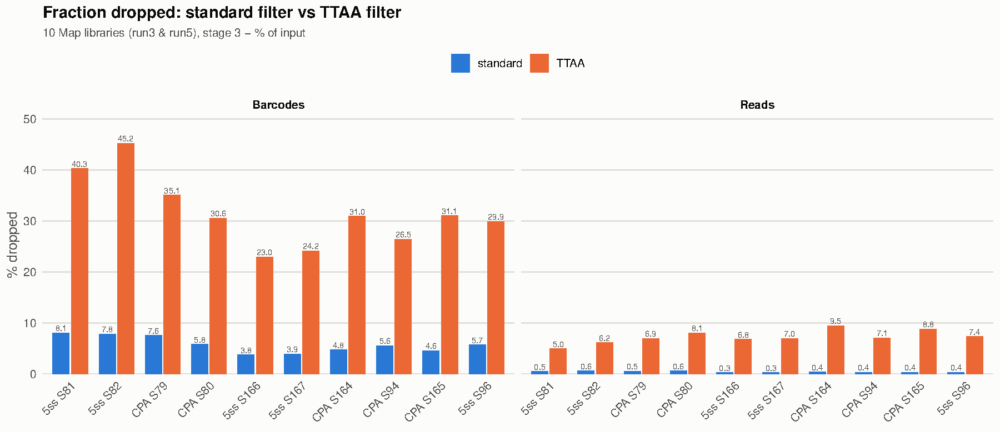
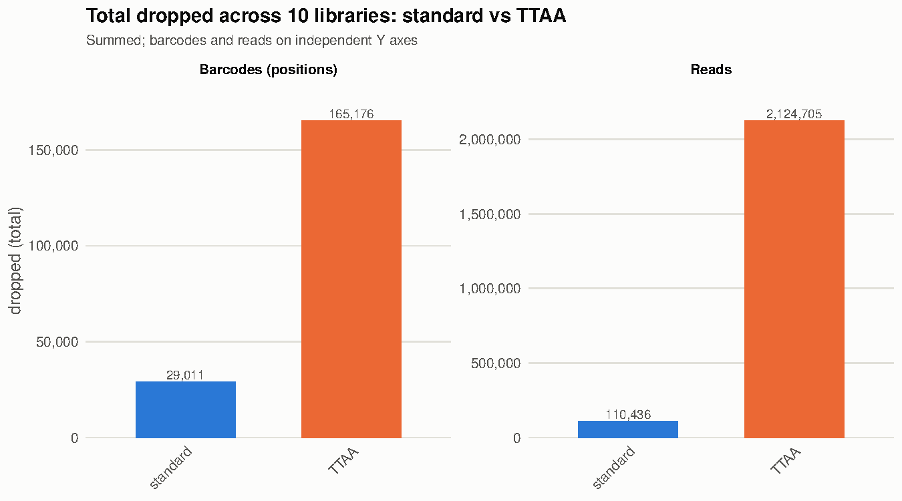
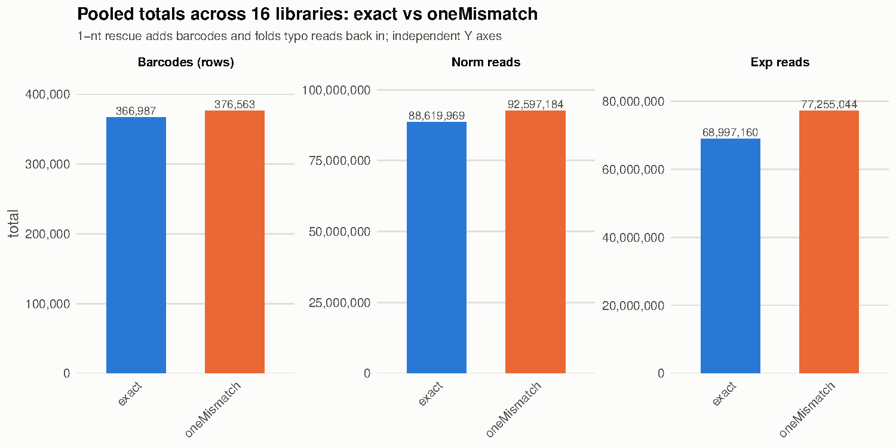
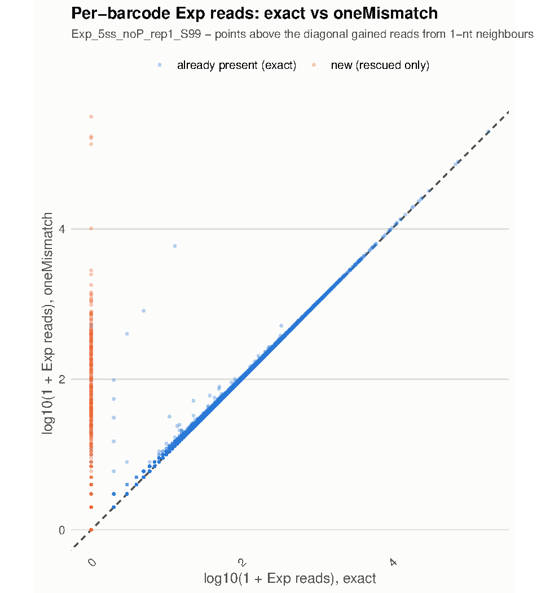

# Lab Notebook

> English translation of the working lab notebook kept alongside this pipeline. Complete and
> unabridged. Two conventions of the original are preserved: paths point at the lab file system
> (`/home/projects/ulitsky/...`), and the two new stages are referred to by their original
> workspace names — `NewScripts/filterMappings_TTAA/filterMappings_TTAA.R` is stage 04 of this
> repository (`scripts/04_filterMappings_TTAA.R`) and `NewScripts/normalizeTRIP_MM/normalizeTRIP_v2_MM.R`
> is stage 07 (`scripts/07_normalizeTRIP_v2_MM.R`). The six figures are included, in
> [figures/](figures/).

## 26 July 2026 – Stage 3: TTAA filter in `filterMappings` (the piggyBac site)

**Goal:** at stage 3, keep only barcodes whose integration sits in a **TTAA** (the piggyBac site).
**Status:** done in a separate copy, the original untouched. Run on a toy dataset – every case passes.

### What was created (everything in `NewScripts/filterMappings_TTAA/`)

| File | What |
|---|---|
| `filterMappings_TTAA.R` | a copy of `filterMappings.R` + an **optional** TTAA filter (new blocks marked `NEW BLOCK`) |
| `hg38_ttaa.bed` | a copy of the TTAA reference (627 MB, 19,784,878 sites, col2 = 0-based TTAA start) |
| `toy_test/` | toy dataset + driver `run_toy_test.sh` + `summarize.R` |

### The rule (coordinates, all 0-based)

`Start` from `analyzeTRIPMapping` is 0-based. In the reference the TTAA sits at a strand-dependent offset:
- `+` → TTAA = `[Start-4, Start)` → we check `Start-4`
- `-` → TTAA = `[Start, Start+4)` → we check `Start`

The test is an **exact** membership of `tt = ifelse(+, Start-4, Start)` in column 2 of
`hg38_ttaa.bed` (no window).
TTAA is a palindrome, so the bed holds the `+` strand only and that is sufficient — no revcomp needed.

### Interface (the flag is optional)

```
without the filter (as the original):  Rscript filterMappings_TTAA.R <path> <name>
with the filter:                       Rscript filterMappings_TTAA.R <path> <name> ttaaFilter <ttaa_bed>
```

Without the `ttaaFilter` flag the behaviour is **identical** to the original.

### Toy test (`toy_test/`, 12 positions, every case)

2 runs (baseline vs filtered), the result checked against a hand-written oracle → **ALL PASS**:

| # | case | baseline | filtered |
|---|---|---|---|
| 1 | `+` on a TTAA | keep | **keep** |
| 2 | `+` not a TTAA | keep | drop |
| 3 | `-` on a TTAA | keep | **keep** |
| 4 | `-` not a TTAA | keep | drop |
| 5 | `+`, TTAA on the WRONG side (the `-` window) | keep | drop |
| 6 | `+`, shifted by 1 (tests the exact match) | keep | drop |
| 7 | a contig with no TTAA at all | keep | drop (+WARNING) |
| 8 | contig edge, `tt<0` (must not crash) | keep | drop |
| 9a| strong, on a TTAA | keep | **keep** |
| 9b| weak near-duplicate next to it | drop (proximity) | drop |
| 10a| **artefact barcode** (not on a TTAA) | keep | drop |
| 10b| weak **genuine** TTAA next to 10a | drop (proximity) | **keep (RESCUE)** |

**The star case 10a/10b:** an artefact barcode (strong, not on a TTAA) sits 5 bp away from a weak
genuine TTAA position carrying a near-duplicate barcode. The TTAA filter runs **before** the
count/position filter: **without the filter** the artefact survives and silences the genuine one
(proximity throws it out), **with the filter** the artefact is removed earlier → the genuine one
**survives** (and the counts of the artefact position are lost — as intended). A detailed
plain-language walkthrough is below, section "The star case 10a/10b – in detail".

Run result: baseline kept 10/12, the TTAA filter kept 4/12 (`104+`, `300-`, `1004+`, `2000+`),
log: `dropped 7 positions as non-TTAA`, `1 too close`.

### Walkthrough of every barcode (barcode → its TTAA coordinate → decision)

The reference `toy_TTAA_reference.bed` (chromosome + 0-based TTAA start):
```
chrT1  100
chrT1  300
chrT1  504
chrT1  601
chrT1  1000
chrT1  1004
chrT1  1996
```

For every input row (`toy.barcodes.bed`) we compute the expected TTAA start
`tt = Start-4` (for `+`) or `tt = Start` (for `-`) and look `tt` up in the reference:

| Barcode (input) | Start, strand | tt = expected TTAA start | is tt in the reference? | Decision |
|---|---|---|---|---|
| `CASE01` | 104, `+` | 104−4 = **100** | yes (`chrT1 100`) | **KEEP** – integration in a TTAA |
| `CASE02` | 204, `+` | 204−4 = **200** | **no** | **DROP** – not in a TTAA |
| `CASE03` | 300, `-` | **300** | yes (`chrT1 300`) | **KEEP** |
| `CASE04` | 400, `-` | **400** | **no** | **DROP** |
| `CASE05` | 504, `+` | 504−4 = **500** | **no** (the file has `504`, but `500` is required) | **DROP** |
| `CASE06` | 604, `+` | 604−4 = **600** | **no** (there is `601` – off by one) | **DROP** |
| `CASE07` | 100, `+` (chrT2) | 96 | chrT2 is **absent** from the reference | **DROP** (+WARNING) |
| `CASE08` | 2, `+` | 2−4 = **−2** | **no** | **DROP** |
| `CASE09A` | 1004, `+` | **1000** | yes (`chrT1 1000`) | **KEEP** |
| `CASE09B` | 1008, `+` | **1004** | yes (`chrT1 1004`) | **DROP – by proximity** (see below) |
| `CASE10A` | 2005, `+` | **2001** | **no** | **DROP** – not in a TTAA |
| `CASE10B` | 2000, `+` | **1996** | yes (`chrT1 1996`) | **KEEP** |

The three "traps" in detail, with the actual file lines:

**Case 5 – there is a TTAA, but on the wrong side.**
```
input (toy.barcodes.bed):   chrT1  504  505  CASE05:100  100  +
```
Strand `+` → we expect a TTAA at `tt = 504-4 = 500`. The reference has no row `500` (it has
`chrT1 504`). `504` would fit a `-`-strand integration (`tt = Start`), but ours is `+`. → **DROP**
(we do not let the offset of the other strand produce a false keep).

**Case 6 – off by one (exact match, no window).**
```
input:   chrT1  604  605  CASE06:100  100  +
```
`tt = 600`. The reference has `601`, but not `600`. The match is exact → **DROP** (there is no ±1 window).

**Case 9b – the coordinate is a real TTAA, but it is proximity, not the TTAA filter, that removes it.**
```
input:   chrT1  1008  1009  CASE09B:20   20   +   (weak, near-duplicate of 9a)
nearby:  chrT1  1004  1005  CASE09A:100  100  +   (strong, 9a)
```
`tt = 1004` is in the reference → it would pass the TTAA test. But it is 4 bp from 9a, its count
`20 ≤ 25%` of `100`, and the barcode differs by one letter → it is removed by the **old proximity
filter** (not by TTAA). This shows that the two filters work together.

### The star case 10a/10b – in detail (why the insertion point matters)

**Two neighbouring positions.** 5 bp apart sit two positions with almost identical barcodes:

| position | barcode | count | on a TTAA? | what it is |
|---|---|---|---|---|
| **CASE10A** | `CASE10A` | 100 (strong) | **no** | **artefact barcode** – a mapping error, NOT a real piggyBac integration |
| **CASE10B** | `CASE10B` | 20 (weak) | **yes** | a real TTAA integration |

The barcodes differ by one letter – the artefact is a "corrupted copy" of the real one.

**The TTAA filter runs BEFORE the count/position filter.** Inside the loop, each position is first
checked for a TTAA, and only then for "is it too close to a strong neighbour" (proximity). So a
non-TTAA position is thrown out before proximity gets to act.

**What the old proximity filter does.** If two positions sit right next to each other and their
barcodes are nearly identical, it treats the weak one as an "echo" of the strong one and drops the
weak one. Strong positions are processed first and become "anchors" the rest are compared against.

**WITHOUT the TTAA filter – we lose the real one:**
1. The strong **CASE10A** (artefact) is processed first → survives → becomes an anchor.
2. The weak genuine **CASE10B** nearby (5 bp), `20 ≤ 25%` of `100`, barcode a near-duplicate → is
   dropped as an "echo".
3. Outcome: the artefact stayed, the real one was lost. Bad.

**WITH the TTAA filter – the real one survives:**
1. **CASE10A** → not on a TTAA → dropped immediately and never becomes an anchor.
2. **CASE10B** → on a TTAA → nothing suppresses it → survives.
3. Outcome: artefact removed, real one survived. Correct.

**Why the insertion point matters:** the TTAA check is placed early, before a position can become
an anchor. Put it later and the artefact would have already crushed the real one before being
removed itself.

**About the counts (yes, we lose some – and that is right):** if the strong position is not in a
TTAA while the weak one is, the strong one is deleted, the weak one stays, and the strong one's
counts (100) are lost. That is expected: a non-TTAA position is not a real piggyBac integration
(piggyBac always lands in a TTAA), its counts are artefactual, and discarding them is the point of
the filter. Still, this is genuine "data loss" that will have to be measured on real data.

### How to run / how to eyeball it

```
bash /home/projects/ulitsky/artemti/2026/NewScripts/filterMappings_TTAA/toy_test/run_toy_test.sh
```
Prints an expected-vs-got table + PASS/FAIL. Files to eyeball: `RESULT_without_ttaa.bed` (no filter)
vs `RESULT_with_ttaa.bed` (with filter).

### Open questions

- **The `analyzeTRIPMapping` version** (`V3` in decent_scripts vs `V3-1` in Igor's) shifts the minus
  strand by 1 bp – confirm which one produced the target tables before running on real data.

---

## 26 July 2026 – Stage 3 TTAA filter: analysis on real data (10 Map libraries, LSF)

> Continuation of the entry "26 July 2026 – Stage 3: TTAA filter" above (after its "Open questions" section).

**Goal:** measure how much data the TTAA filter from the "26 July 2026 – Stage 3" entry actually
loses. `filterMappings_TTAA.R` was run on **10 real Map libraries** (run3 + run5) in **two modes**:
baseline (no flag, = the original) and with `ttaaFilter`. The run scripts and all results are in
`NewScripts/filterMappings_TTAA/analysis/`.

### What was done

- 10 libraries × 2 modes = 20 jobs. From each log we extracted: how many positions/reads went in,
  how many the ordinary proximity filter dropped, and how many the TTAA filter dropped.
- Full numbers for all columns are in `summary.csv`, absolute path:
  `/home/projects/ulitsky/artemti/2026/NewScripts/filterMappings_TTAA/analysis/summary.csv`.

### Per library (what TTAA specifically drops)

| Library | Input positions | % barcodes dropped by TTAA | % reads dropped by TTAA |
|---|---:|---:|---:|
| 5ss S81  | 10,419  | 40.3 % | 5.0 % |
| 5ss S82  | 14,348  | 45.2 % | 6.2 % |
| CPA S79  | 19,208  | 35.1 % | 6.9 % |
| CPA S80  | 20,653  | 30.6 % | 8.1 % |
| 5ss S166 | 62,754  | 23.0 % | 6.8 % |
| 5ss S167 | 66,383  | 24.2 % | 7.0 % |
| CPA S164 | 84,947  | 31.0 % | 9.5 % |
| CPA S165 | 93,737  | 31.1 % | 8.8 % |
| 5ss S96  | 105,484 | 29.9 % | 7.4 % |
| CPA S94  | 90,754  | 26.5 % | 7.1 % |

### Headline result (whole pool: 568,687 positions, ~27.9 M reads)

| Filter | Barcodes dropped | Reads dropped |
|---|---:|---:|
| ordinary (proximity) | ~29,011 (**5.1 %**) | ~110,436 (**0.4 %**) |
| **TTAA** | ~165,176 (**29.0 %**) | ~2,124,705 (**7.6 %**) |

**Conclusion:** the TTAA filter drops ~**29 % of barcodes** but only ~**7.6 % of reads**. That is,
the discarded positions are predominantly **low-frequency** ones (few reads per barcode) → the
expected noise / mapping artefacts, not the main signal. Exactly the behaviour the filter was built
for (see "The star case 10a/10b" above).

**Figure 1** — % of dropped barcodes and reads per library:



**Figure 2** — TTAA: barcodes vs reads:


**Figure 3** — pool totals:



> Full numbers for all columns: `NewScripts/filterMappings_TTAA/analysis/summary.csv`.

### Correctness checks (all passed)

- **The coordinate offset is right.** Checked directly against the genome: our offset
  (`+`→`Start-4`, `-`→`Start`) puts **64–77 % of TTAA** on real positions, whereas ±1 bp shifts give
  **<6 %** → the offset was chosen correctly, not by luck.
- **baseline == the original.** The positions kept by `filterMappings_TTAA.R` without the flag
  **matched byte for byte** the original `filterMappings.R` (position diff = 0) → the TTAA branch
  breaks nothing on the "ordinary" path.
- **`+`/`−` are dropped in a balanced way** (`drop_pct_plus` ≈ `drop_pct_minus` in every library) →
  the minus-strand offset is right (no skew to one side).
- **The standard-vs-TTAA comparison is internally valid:** both modes are the same script, differing
  exactly by the presence of the flag, so the difference in numbers is the pure effect of the TTAA filter.

### Three bugs from the first run (fixed)

1. **run1 – old format.** In run1 the barcodes are written without the `:count` suffix → the script
   crashed while parsing. run1 was **excluded** from the analysis (incompatible format, not a filter bug).
2. **Reads were counted from the truncated `.bed` → NA.** The read count was taken from the `.bed`,
   which is truncated → the result was `NA`. Fixed: read the counts from `.poses`.
3. **PNG rendering crashed (exit 132 / SIGILL)** on some LSF nodes (a CPU-instruction incompatibility
   in R's graphics back end). Workaround: render R→**PDF**, then PDF→PNG via **Ghostscript**.

### Caveat (interpreting per-library numbers)

- **run3 `5ss_Map` / `CPA_Map`** (the old libraries, S79–S82) drop **30–45 %** of barcodes – there
  really are more non-TTAA positions there (worse quality / older protocol); this is the upper bound.
- **`Map_*_noP`** libraries – **23–31 %**, closer to the "typical" artefact fraction.
- So the 29 % across the pool is an average of the "dirty" old libraries and the cleaner noP ones;
  when interpreting a specific library, look at its own row rather than at the pool.

---

## 25–26 July 2026 – Stage 7 (`normalizeTRIP_v2.R`): what it does + how we handled mismatches

**The original file:** `/home/projects/ulitsky/lidiag/R/scripts/decent_scripts/normalizeTRIP_v2.R`

---

### What the script does today

#### What this step is

It is a **join of three tables by barcode** into one row per barcode.
It is launched once per row of `combos.txt`:

```
Rscript normalizeTRIP_v2.R  path  path_norm  nameMap  nameNorm  nameExp  effLength  doReverseComplement
```

Three inputs (all keyed by the 18-nt integration barcode):

| Input | File | What it provides | Where the barcode is |
|---|---|---|---|
| **Map**  | `{nameMap}.retained_barcodes_genuine.bed` | genomic position Chr/Pos/Strand + the map count | column `V4` |
| **Norm** | `{nameNorm}.counts.txt.gz` | gDNA count – the normalization denominator | 1st column |
| **Exp**  | `{nameExp}.counts.txt.gz`  | RNA read count – expression / splicing | 1st column |

Output: `{nameExp}.combined_counts.txt` with columns `norm  exp  Chr  Pos  Strand  map`
(row = barcode) + a `.bed` of the same name.

> Important: "normalization" here means "put the norm denominator next to exp".
> The division itself, `exp.norm = log2((1+exp)/(1+norm))`, is computed LATER, at Stage 9
> (`table_annotation.R`), not here.

---

#### Step by step, what the script does today

1. **Reads Map** (line ~38). The barcode is truncated to its first `effLength` characters
   (line 41) and the dictionary `barcodeToInd` is built: barcode → map row number(s) (line 43).
   > In `combos.txt` for set1 `effLength = 18` everywhere, and the barcode is 18 nt anyway, so in
   > practice the truncation cuts nothing.

2. **Reads Norm** (line 50) and filters it:
   - keeps barcodes of **exactly** `effLength` (line 53),
   - keeps only those with `norm ≥ 2` (`minNormReads = 2`, line 54),
   - sums the counts per barcode (line 57),
   - **discards everything absent from Map** (line 60) → `norm` must match `Map`.

3. **Reads Exp** (line 67): sums per barcode, keeps length `== effLength`.

4. **Keeps only single-position barcodes** (line 88): if the (truncated) barcode points at more than
   one map position, it is discarded.
   > The check is needed because truncating to `effLength` can "glue" two different barcodes onto
   > the same position key.

5. **Assembles the final table** (lines 90–100):
   - `norm` comes from Norm, `exp` from Exp, `Chr/Pos/Strand/map` from Map,
   - **KEY POINT:** if a barcode is **absent from Exp**, `exp = NA`, and then `df[is.na(df)]=0`
     (line 100) turns it into **0**.
   - Result: a barcode present in Map + Norm but **missing from Exp** still enters the table, with
     `exp = 0`.

**The asymmetry of the current logic:**
- Norm **must** match Map (otherwise it is discarded, line 60).
- Exp does **NOT** have to match – absence from Exp yields `exp = 0`.

---

#### A mini example (in plain words)

Briefly, on 3 barcodes (the full case-by-case walkthrough is in the toy test below):
- `ACGTAC` is in Map+Norm+Exp → row `norm=12, exp=200`,
- `GGAATT` is in Map+Norm but **absent from Exp** → the row still exists, but `exp=0` (that very asymmetry),
- `CCCCCC` is **not in Map** → discarded (it has no position).

---

### How we handled mismatches (`normalizeTRIP_v2_MM.R`)

**Goal:** when joining Map⊕Norm⊕Exp, tolerate a barcode mismatch so that sequencer "typos" are
picked up by the real map barcode.
**Solution:** the number of allowed mismatches is **hard-fixed at 1**, switched on by the
`oneMismatch` **flag** (without the flag – as the original). The reference is the genuine map
barcodes; Norm/Exp reads 1 nt away from a genuine one are attributed to it and the counts summed;
an exact match takes priority; **ambiguous ("tied") ones are discarded**; unmatched ones, as before,
do not enter the table (they have no position).

> **A "tie" (ambiguous barcode)** is a read sitting 1 nt away from **two (or more) different**
> genuine barcodes at once. It is unclear which one it belongs to, so we do not assign it at random
> but **discard** it (otherwise we risk adding reads to the wrong integration and distorting the signal).

**Why the tolerance is 1, and why 2+ is deliberately unsupported.** The "typo dictionary" is built
for **all** genuine barcodes at once (up to ~10^5–10^6 of them), and its size grows fast with the
number of allowed substitutions: at 2 substitutions memory and time grow roughly ~25-fold, at 3 –
by hundreds of times.

**Norm and Exp are matched against the dictionary independently.** The dictionary is built only from
the genuine Map barcodes. Both Norm and Exp are matched against that dictionary independently; they
are never compared with each other and never merged together. So only reads within 1 nt of a genuine
Map barcode are rescued. A read 2 nt from every genuine barcode is not picked up, even if it is 1 nt
from some Norm or Exp barcode. There are no chains of the form Exp → Norm → Map; Norm barcodes never
act as intermediate anchors for Exp.

**Status:** done in a separate copy, the original untouched. Run on the toy dataset – **ALL PASS**,
and without the flag it matched the real `normalizeTRIP_v2.R` byte for byte.

#### What was created (everything in `NewScripts/normalizeTRIP_MM/`)

| File | What |
|---|---|
| `normalizeTRIP_v2_MM.R` | a copy of `normalizeTRIP_v2.R` + optional `NEW BLOCK (MM)` sections; without the `oneMismatch` flag it is identical to the original |
| `toy_test/` | toy dataset + `run_toy_test.sh` + `summarize.R` (hand-written oracle) |

#### The method – a "neighbour hash"

Taken from `igoru/R/trip/cDNA/analyzeCDNAStats_run2.R` (functions `make_neighbor_mapping` /
`find_closest_kosher`; the same pair exists byte for byte in `analyzeCDNAStats.R` and `_v2.R`). We
pre-build a "typo dictionary" of the genuine barcodes (the barcode itself + every 1-substitution
variant) → each Norm/Exp barcode is then resolved with a single hash lookup (O(N+M) instead of
O(N·M)). The tolerance, as in the source, is **exactly 1 substitution**. **Adaptations** relative to
the original: (a) ties are **discarded** rather than "first wins", (b) an exact match takes priority,
(c) a guard against empty input.

#### Interface (the flag is optional)

```
as the original (exact):  Rscript normalizeTRIP_v2_MM.R <path> <path_norm> <nameMap> <nameNorm> <nameExp> <effLength> <doReverseComplement>
1-nt tolerance:           Rscript normalizeTRIP_v2_MM.R <...the same 7...> oneMismatch
```

Without the flag → the MM blocks are skipped → the original behaviour. With `oneMismatch` only two
places change: the Norm snap (before the `%in%` line) and the Exp snap (after the reverse-complement).

#### The toy test

`norm` and `exp` are read counts (how many times a barcode was seen in the Norm and the Exp library).
In the final table every genuine barcode ends up with a pair of numbers: `norm` (the denominator) and
`exp` (expression).

**Input 1 – Map** (`toy_map…genuine.bed`, V4 = genuine barcode, V5 = map count, V6 = strand) – the
"reference" barcodes with a genomic position:
```
chr1  1000  1001  AAAAAAAA  50  +
chr2  2000  2001  CCCCCCCC  30  -
chr3  3000  3001  GGGGGGGG  40  +      (lonely – no typos nearby)
chr5  5000  5001  TATATAAA  25  +      \ differ by 2 nt (Hamming 2) –
chr5  5500  5501  TATATATT  22  +      / this is where the "tie" comes from
```

**Input 2 – Norm** (`toy_norm.counts.txt`, barcode + read count):
```
AAAAAAAA  12     exactly = genuine
AAAAAAAC   4     1 nt from AAAAAAAA (a typo)
AAAAAACA   3     1 nt from AAAAAAAA (a typo)
CCCCCCCC   8     exact
GGGGGGGG   6     exact
AAAACCCC   5     2 nt from AAAAAAAA – no longer a typo
TATATAAA  10     exact
TATATATT   9     exact
TATATAAT   7     1 nt from both TATATAAA and TATATATT – a "tie"
```

**Input 3 – Exp** (`toy_exp.counts.txt`, barcode + read count):
```
AAAAAAAA  200
AAAAAAAC   50    a typo of AAAAAAAA
CCCCCCCC   45
TATATAAA  100
TATATATT   90
TATATAAT   30    a "tie"
GGGGTTTT   15    1 nt from nobody
```

2 runs (no flag / with `oneMismatch`) + a run of the real original, checked against a hand-written
"oracle" → **ALL PASS**.

**Result: what each genuine barcode gets** (the numbers are its final `norm` and `exp` in the output table):

| genuine | position | norm without flag | norm with `oneMismatch` | exp without flag | exp with `oneMismatch` | what happened |
|---|---|--:|--:|--:|--:|---|
| `AAAAAAAA` | chr1:1000 | 12 | **19** | 200 | **250** | typos picked up: norm +4+3, exp +50 |
| `CCCCCCCC` | chr2:2000 | 8 | 8 | 45 | 45 | exact match only |
| `GGGGGGGG` | chr3:3000 | 6 | 6 | 0 | 0 | lonely, absent from Exp → `exp=0` (fallback) |
| `TATATAAA` | chr5:5000 | 10 | 10 | 100 | 100 | exact; did NOT take the tie TATATAAT |
| `TATATATT` | chr5:5500 | 9 | 9 | 90 | 90 | exact; did NOT take the tie TATATAAT either |

**The fate of the "foreign" reads** (those not among the genuine ones) under `oneMismatch`:

| read | norm | exp | what it resembles | outcome |
|---|--:|--:|---|---|
| `AAAAAAAC` | 4 | 50 | 1 nt from `AAAAAAAA` | **merged into AAAAAAAA** |
| `AAAAAACA` | 3 | – | 1 nt from `AAAAAAAA` | **merged into AAAAAAAA** |
| `AAAACCCC` | 5 | – | 2 nt – from nobody | discarded (no position) |
| `GGGGTTTT` | – | 15 | from nobody | discarded (no position) |
| `TATATAAT` | 7 | 30 | 1 nt from TWO genuine ones | discarded (**tie**) |

**Internal-logic check (it adds up):**
- **The typo dictionary = 121 keys (the number, step by step).**
  1. We have 5 genuine barcodes. For each we put into the dictionary the barcode itself and every
     string differing from it by exactly one letter. For an 8-nt barcode that is 8 positions × 3
     other letters = 24 variants, plus the barcode itself, i.e. 25 strings per genuine.
  2. For 5 genuine that gives 5 × 25 = 125 generated strings. Note: these are neighbour strings
     invented by the algorithm; they do not occur in the real input files.
  3. Two of those strings, `TATATAAT` and `TATATATA`, appear twice, because each of them sits 1 nt
     away from two genuine barcodes at once, both `TATATAAA` and `TATATATT` (which themselves differ
     from each other by 2 nt). So the number of distinct strings is not 125 but **123**.
  4. Those same two strings are ambiguous — we call them "ties": it is unclear which of the two
     genuine ones to attribute them to, so we discard them. That leaves 123 − 2 = **121** keys.
  An example of a tie: `TATATATA` is simultaneously `TATATAAA` with a substitution at position 7 and
  `TATATATT` with a substitution at position 8. No such string exists in the input data; the
  algorithm generated it itself. The fact that the script reported exactly 121 confirms that both
  the variant generation and the tie rejection work correctly.
- **Without the flag = the original, byte for byte.** The file the new script writes without the flag
  was compared with `diff` against the output of the real `normalizeTRIP_v2.R` – no differences. So
  the MM branch does not break the ordinary path.

**Run:** `bash /home/projects/ulitsky/artemti/2026/NewScripts/normalizeTRIP_MM/toy_test/run_toy_test.sh`

#### Notes for the future (before real data)

- **Speed.** Generating the neighbours with loops is correct but slower than the vectorised cDNA
  version. For real ~10^5–10^6 barcodes at 1 nt it is acceptable; if it turns out slow, rewrite the
  variant generation in a vectorised way.
- **The `exp=0` fallback was not changed** – MM is orthogonal to the question "should a barcode be
  required in Exp" (see the subsection "What the script does today"). If that is needed later, it is
  a separate edit of line 100.

---

### Analysis on real data (16 set1 combos, LSF) – 28 July 2026

**Goal:** measure how much the `oneMismatch` flag actually adds on real data.
`normalizeTRIP_v2_MM.R` was run on **16 combos** from `set1_combined_1/combos.txt` in two modes:
**without the flag** (= exact = the original) and **`oneMismatch`**. The selection covers the
constructs **5ss_noP / CPA_noP / 5ss / CPA** and different RNA libraries
**Exp / PolyA / total / PolyAminus / nonspliced**. The harness and all results are in
`NewScripts/normalizeTRIP_MM/analysis/`.

**Feasibility:** the neighbour dictionary for 44,176 genuine barcodes holds **2,412,442** keys, one
run takes ~**1.5–2 min**, peak memory ~**1.1 GB**. On set1 everything computes without trouble as
ordinary cluster jobs.

**Headline result (pool of 16 jobs):**

| Metric | exact | oneMismatch | gain |
|---|---:|---:|---:|
| Barcodes (rows) | 366,987 | 376,563 | **+2.61 %** |
| Norm reads | 88,619,969 | 92,597,184 | **+4.49 %** |
| Exp reads | 68,997,160 | 77,255,044 | **+11.97 %** |

> **Important about barcodes/norm:** many jobs in the selection use the same Map and the same Norm
> (only the RNA library differs). There are only **8** distinct (Map, Norm) pairs, so in the pool
> totals the barcodes and norm are counted several times over. For those it is fairer to look at a
> single pair: the barcode count grows by **+2.4–2.7 %** (the large noP sets) and by **+5.2–7.9 %**
> (the small promoter sets), the norm reads by **+4.0–5.8 %**. The exp reads, on the other hand,
> differ across all 16 jobs, so the pooled **+12 %** is legitimate.

**Gain in exp reads per job** (descending). The columns "+% bc" and "new bc" are the same for jobs
sharing the same Map and Norm:

| Job | exp exact → oneMismatch | +% exp | +% bc | new bc |
|---|---:|---:|---:|---:|
| 5ss PolyAminus S91 | 869,701 → 1,852,071 | **+113.0 %** | +2.4 % | 728 |
| 5ss total S79 | 2,115,642 → 3,224,170 | +52.4 % | +2.4 % | 728 |
| 5ss Exp(noP) S100 | 978,488 → 1,408,226 | +43.9 % | +2.4 % | 762 |
| 5ss Exp(noP) S99 | 2,223,591 → 3,120,170 | +40.3 % | +2.4 % | 728 |
| 5ss nonspliced S5 | 660,007 → 816,893 | +23.8 % | +2.4 % | 728 |
| CPA PolyAminus S89 | 4,793,055 → 5,473,940 | +14.2 % | +2.7 % | 800 |
| CPA total S77 | 4,503,392 → 4,968,288 | +10.3 % | +2.7 % | 800 |
| CPA Exp(noP) S98 | 7,014,098 → 7,547,873 | +7.6 % | +2.6 % | 787 |
| CPA Exp(noP) S97 | 4,822,267 → 5,180,927 | +7.4 % | +2.7 % | 800 |
| CPA Exp(prom) S55 | 5,882,468 → 6,297,323 | +7.1 % | +5.2 % | 106 |
| 5ss Exp(prom) S57 | 5,765,818 → 6,164,239 | +6.9 % | +7.9 % | 91 |
| CPA Exp(prom) S54 | 8,737,793 → 9,316,565 | +6.6 % | +5.2 % | 106 |
| CPA nonspliced S1 | 2,682,736 → 2,859,738 | +6.6 % | +2.7 % | 800 |
| CPA PolyA S81 | 6,842,848 → 7,280,172 | +6.4 % | +2.7 % | 800 |
| 5ss PolyA S83 | 5,651,734 → 5,990,100 | +6.0 % | +2.4 % | 728 |
| 5ss Exp(prom) S56 | 5,453,522 → 5,754,349 | +5.5 % | +7.6 % | 84 |

**What this shows:**
- **Norm and barcodes.** Typo rescue raises them modestly and consistently (norm ~+4–5 %, barcodes
  +2–8 %). That is the expected effect: a genuine barcode gets back its own reads that carried one error.
- **Exp** – the effect **varies a lot (from +5.5 % to +113 %)** and is the larger the **shallower**
  the library is in exp. The record holder is `PolyAminus_5ss S91` (exp 0.87M → 1.85M, +113 %): there
  are more rescued "typo" reads than exact ones.
- **The "new" barcodes (84–800 per job)** are NOT new barcodes in Map (a barcode absent from Map has
  nowhere to come from). They are genuine barcodes already present in Map that, in exact mode, never
  reached the final table because they had fewer than 2 exact norm reads. After the 1-nt neighbours
  are picked up, their norm reaches the `minNormReads = 2` threshold and they appear in the output table.

**Figure 1** — % gain per library (barcodes/norm/exp):


**Figure 2** — pool totals: exact vs oneMismatch:



**Figure 3** — exp per barcode: exact vs oneMismatch (Exp_5ss_noP_rep1_S99):



> Fig 3: the blue points lie almost on the diagonal (for barcodes that already existed, exp grew a
> little), the orange ones lie along the `x=0` axis – these are the **new** barcodes (absent
> altogether in exact, appearing under `oneMismatch` thanks to the rescue).

**Caveats / what to check next:**
- **The `+113 %` for PolyAminus** – it is worth eyeballing that these really are 1-nt typos rather
  than "over-rescue" of low-frequency foreign barcodes: for a real typo the count should be far below
  the count of the genuine barcode it attaches to. Worth a spot check before trusting shallow libraries.
- **Ties** were not logged separately in these runs (the script simply discards them). If needed, a
  counter of ambiguity-dropped reads can be added.
- The exact-vs-`oneMismatch` comparison is internally valid: the same script, differing exactly by the flag.

**Operational notes:**
- Resources: `bsub -q short -n 1 -R "rusage[mem=8000]"` with headroom (actually ~1.1 GB).
- **LSF pitfall:** the dependency `-w 'done(mmnorm)'` (the name matches many jobs submitted in a
  loop) fired **prematurely** – the aggregator started while some jobs were still computing, and
  `summary.csv` ended up incomplete. The right way: wait until **all** output files exist and only
  then launch the aggregator. For the future – do not rely on `done(<name>)` for a batch; wait for
  the files or use a job array.
- Full numbers for all columns: `NewScripts/normalizeTRIP_MM/analysis/summary.csv`.
