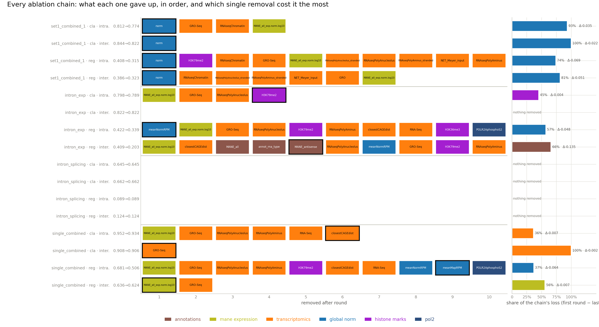
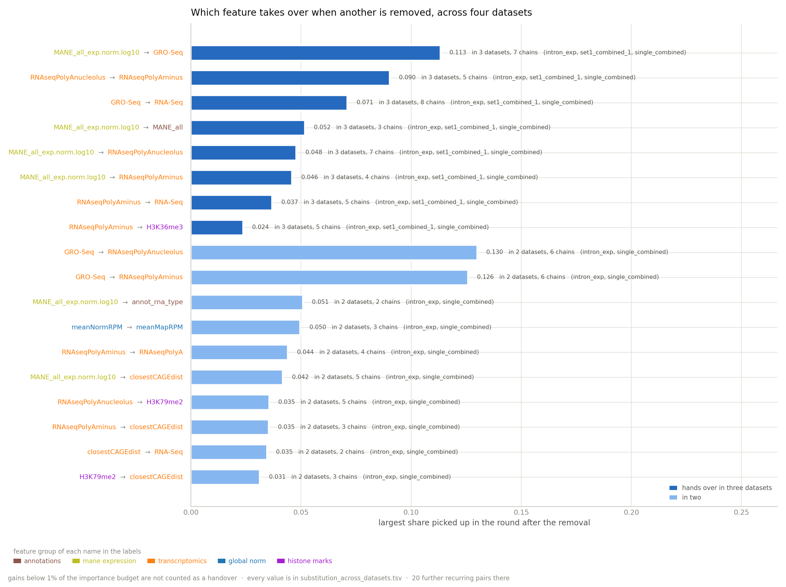
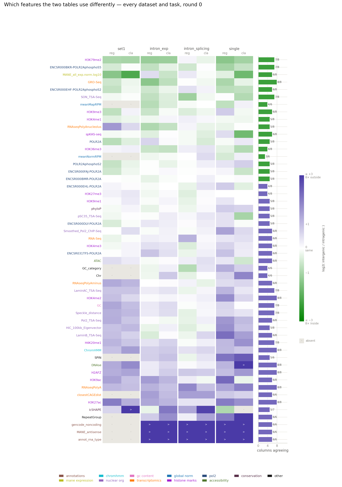
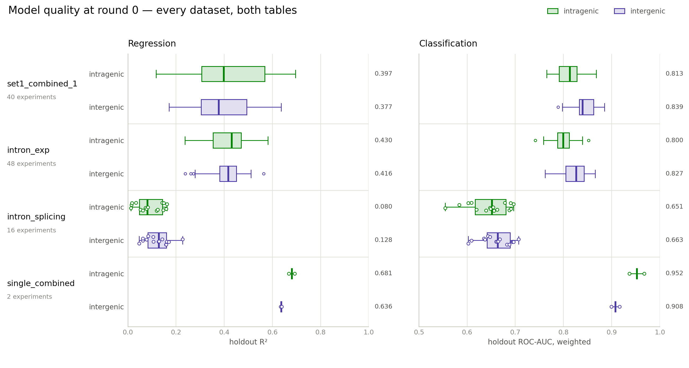
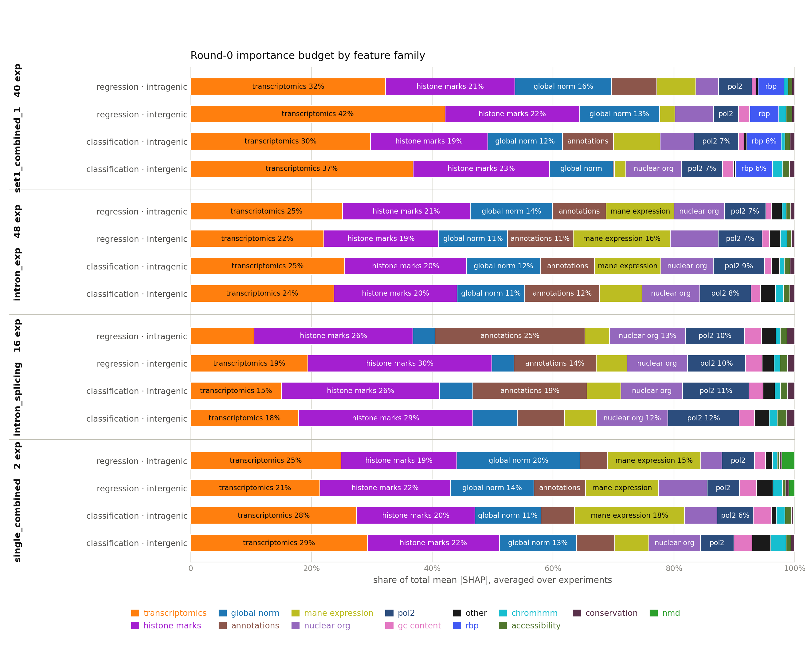
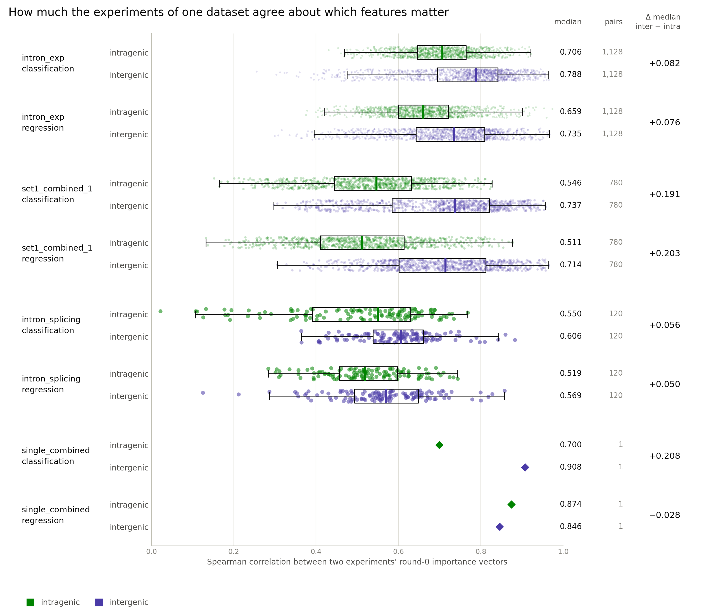
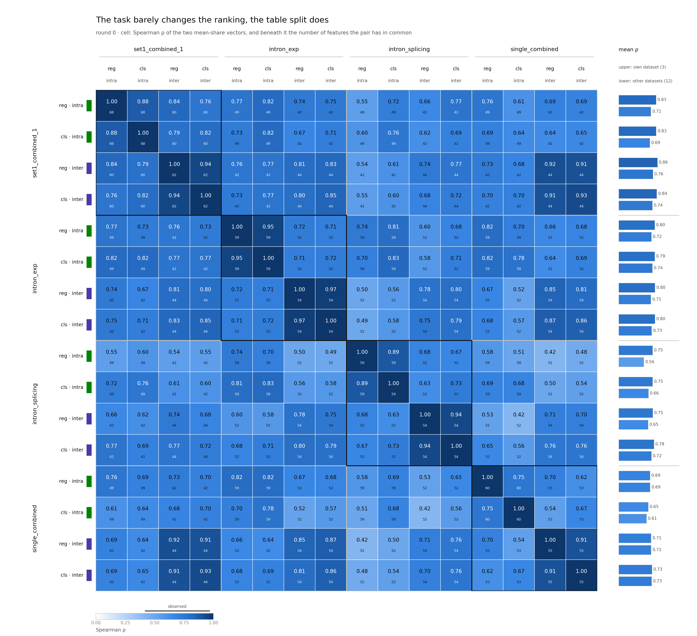

# Feature removal analysis — draft

What we do. We train XGBoost to predict reporter behaviour from the local genomic context.
Four datasets, two tasks (regression and classification), two tables (intragenic and intergenic).
That makes 16 chains.

What feature removal means. Every round we drop the feature holding the largest share of the
importance and retrain. We keep going until no feature holds more than 10 % of the total
importance.

Why bother. The drop in quality is not the interesting part, it is usually small. What is
interesting is who picks up the role of the feature that left. If one feature replaces another,
they carry the same information, and the model was never using both at once.

---

## 1. Every chain on one page

**How to read it**

- A row is one chain, that is a dataset plus a task plus a table. 16 rows in total.
- A column is the round number.
- A cell is the feature that was removed after that round.
- The colour of a cell is the feature's group, not the feature itself. The question here is not
  which exact feature left, but what kind of information the model gives up first.
- A black frame around a cell marks the most expensive removal of that chain.
- The numbers on the left of a row are the metric at the start and at the end of the chain.
- The bar on the right is the share of the whole quality loss that this one expensive removal
  took.
- An empty row means the chain removed nothing.

**Conclusions**

- The model gives up first either the integration copy number (blue, `norm` and `meanNormRPM`) or
  the host gene expression (olive). From the second round on it is almost all orange
  transcriptomics. So a lot of the quality there is held up by technical features.
- All four rows of `intron_splicing` are empty. No feature reached 10 % on average over the
  experiments.

---

## 2. Which feature substitutes for which

**How to read it**

- A row is a pair of who was removed and who grew.
- The length of the bar is how much the successor's share grew in the next round.
- The colour of the bar is in how many different datasets the pair showed up. Dark is three
  datasets, light is two.
- How the gain is computed. Each model's importance shares add up to 1, and the share of a
  feature is first averaged over all experiments of the chain. The gain is then that averaged
  share in the round after the removal minus the same share in the round before it.
- The bar shows the largest gain over all the chains where the pair occurred, not the average.
  The average is in the `.tsv` file, column `mean_gain`.

**Conclusions**

- Almost every name in the top rows is orange, that is transcriptomics. These features substitute
  for each other.
- The level of gene expression can largely be replaced by the plain fact that a gene is there at
  all.

---

## 3. What the two tables use differently

**How to read it**

- A row is a feature, a column is a dataset and a task. 8 columns in total.
- The colour of a cell is `log2(intergenic / intragenic)`.
- Green means it matters more inside a gene, violet means it matters more outside.
- A greater-than or less-than sign inside a cell means the value hit the edge of the scale, that
  is the difference is more than eightfold.
- A grey tile with a dot is not a value. It is a third state: the feature does not exist in that
  dataset.
- The colour of the label on the left is the feature's group.

**Conclusions**

- Inside a gene what matters is transcription signal running through the locus itself.
- Outside what matters is the answer to whether there is a gene or a regulatory element here at
  all.
- `closestCAGEdist` does not really fit the pattern.

---
---

# Part 2. Descriptive analysis

## 4. How well the models work at all

## 5. What the models rely on

**How to read it**

- A bar is the whole importance budget over the full feature set, split by functional feature
  group.
- Every bar adds up to 100 %.

**Conclusions**

- In three datasets out of four the largest piece goes to transcriptomics (the same conclusion as
  in part 1).
- Histone marks matter more than we used to think.

## 6. Do the experiments agree with each other

**How to read it**

- Take one chain. It holds many experiments, and each has its own feature importance vector.
- We compute the Spearman correlation between every pair of experiments. That is a rank
  correlation.
- A dot is one such pair of experiments.

## 7. Is the feature ranking the same everywhere

**How to read it**

- A 16 by 16 matrix. Both the row and the column are a chain.
- A cell holds two numbers. The big one is the Spearman correlation between the importance
  vectors of the two chains, the small one below it is how many shared features it was computed
  on.
- Darker means the rankings are closer. The scale is fixed from 0 to 1, and zero would be pure
  white.
