# ML analysis: what does the genomic context explain about reporter expression?

Two TRIP reporter libraries in K562, `5ss_noP` and `CPA_noP`, about 34,000 barcoded
integrations each.
The question is how much of that readout can be predicted from the local genomic
context alone, and which parts of the context carry the signal.

Everything below comes from XGBoost models. Depth is chosen by 3-fold cross validation
and reported on a 15% holdout. Splits are made by genomic coordinate, so two
integrations sitting next to each other never end up on both sides of a split. Without
that, neighbouring barcodes share almost identical features and the holdout would leak.

Raw numbers per model are in `results_cls_baseline.tsv`, `results_cls_nohostexp.tsv`,
`results_reg_baseline.tsv`, `results_reg_nohostexp.tsv`. All figures are in `figures/`.

---

## Features

**NMD** feature describes whether the insertion is predicted to turn the host transcript into an NMD
  substrate. Values: 1/0. Computed in the `NMD/` part of this repository.

### Two tables per library

Every model is trained twice, on two versions of the same data.

- **intragenic** - only integrations that fall inside an annotated gene, about 8,400 rows.
  Positional features are kept.
- **intergenic** - all integrations, about 34,000 rows, but the positional features are
  removed.

---

## Quality metrics

### Balanced accuracy

Recall is measured for each class separately and the two are averaged.

$$\text{balanced accuracy} = \frac{R_{+} + R_{-}}{2}, \qquad R = \frac{\text{correctly called}}{\text{all barcodes of that class}}$$

Inside genes 80% of barcodes are expressed. A model that answers "expressed" every time is
right 80% of the time and never finds a silent one. Plain accuracy calls that 0.80,
balanced accuracy calls it 0.50. Our intragenic models reach 0.83 to 0.85, so they really
do find both classes.

### F1, macro and weighted

F1 is the harmonic mean of precision and recall of one class. Two classes give two F1
values, averaged in one of two ways.

$$F1_k = \frac{2 P_k R_k}{P_k + R_k}$$

**Macro** averages them with equal weight. **Weighted** averages them in proportion to how
many barcodes each class has, so the bigger class dominates. Macro is the honest one here.
On the intragenic test sets macro F1 is 0.84 to 0.86 and weighted F1 is 0.89 to 0.91, and
the gap is just the majority class flattering the weighted number.

### ROC-AUC, macro and weighted

**Macro ROC AUC** calculates the ROC AUC score for each class individually (treating it as a "class vs. rest" problem) and then takes the unweighted arithmetic mean of those scores

**Weighted ROC AUC** calculates the ROC AUC for each class and computes the average, but weights each class's score by its support

---

## How to read the SHAP figures

Colour is mean absolute SHAP, the average contribution of a feature to the prediction
across all barcodes. Rows are the two libraries, columns are features.

### Black cells

A black cell means that the feature was not included in the model for that library. Features absent from both models are omitted entirely, so each black cell corresponds to a feature present in one library but not the other. This affects only about 9–10 of ~90 features per figure and mostly involves rare repeat classes or host RNA types.

A feature may be missing from one library but retained in the other for three main reasons:

1. **The category never occurs in that library.** The two libraries are independent
   experiments and the transposon landed in different places. `RepeatGroup_srpRNA` has one
   barcode in `CPA_noP` and none in `5ss_noP`, so the column exists for one library only.
   Most black cells are of this kind.
2. **A whole chromatin state was filtered out.** The pipeline counts how many barcodes
   each ChromHMM state has inside genes, and any state with fewer than 10 is removed, from
   both tables at once. `ZNF/Rpts` has 43 barcodes in `CPA_noP`, but only 9 of them are
   inside a gene, one short of the threshold, so all 43 are dropped. In `5ss_noP` there are
   13 inside genes, so the state stays. One barcode of difference decides it, and this is
   the largest black cell in the figures.
3. **The level was constant on the training rows.** These had a single barcode in the
   whole table, and it ended up in the holdout, so across the training rows the column was
   zero everywhere. A column that never changes teaches the model nothing, so it is
   removed before fitting.

Features that were removed on purpose, the "inside a gene" flags in the intragenic table
and the seven positional features in the intergenic one, are missing for both libraries
at once, so they fall out of the figure entirely rather than showing up as black.

### White cells and the `white_pct` parameter

`white_pct = 20` means the lowest 20% of absolute SHAP values are treated as effectively
zero and drawn white. This suppresses noise and makes the colour scale informative for
the features that matter.

### The log colour scale version

The same values with a logarithmic colour normalisation. Absolute SHAP spans more than
two orders of magnitude, so on a linear scale everything below the leaders collapses into
one pale shade. The log version separates the middle of the range.

---

## 1. Classification: is the reporter expressed?

Target is `meanRPM > 0.1`. That gives 61% positives in `5ss_noP` and 64% in `CPA_noP`
over all barcodes, and about 80% inside genes. Classes are balanced enough that no
weighting is needed, but the 80/20 split inside genes matters when reading the numbers,
see below.

### Model quality

**Left: intragenic. Right: intergenic.**

<a href="figures/cls_baseline_metrics_intragenic.png">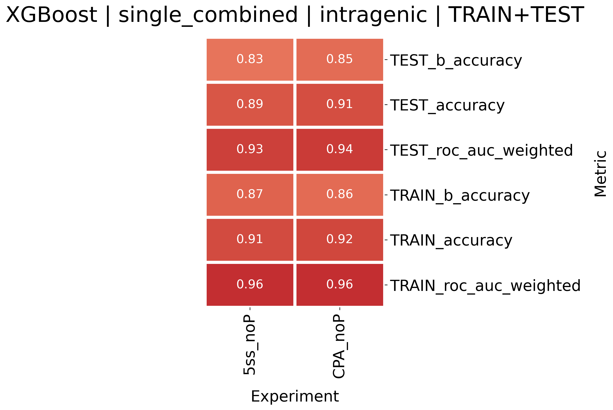</a>
<a href="figures/cls_baseline_metrics_intergenic.png">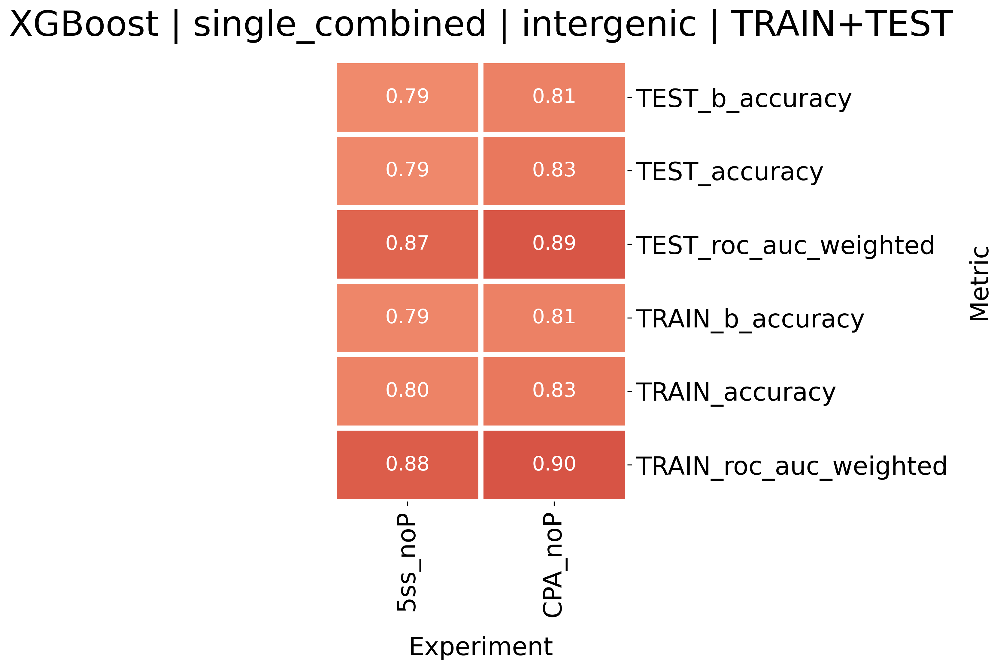</a>

*Click a figure to open it at full resolution.*

### Feature importance

**Top: intragenic. Bottom: intergenic.**

[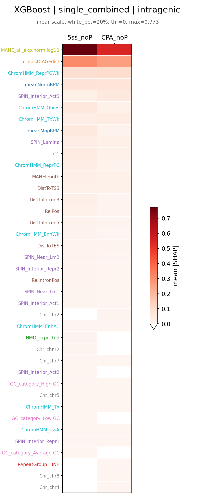](figures/cls_baseline_shap_intragenic.png)

[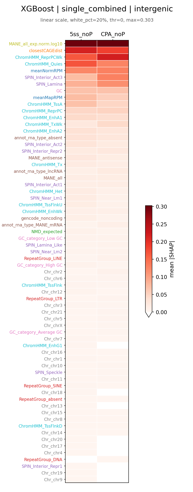](figures/cls_baseline_shap_intergenic.png)

*Click a figure to open it at full resolution.*

Only about 35 of the roughly 100
columns get any non-zero contribution in the intragenic model. The rest are exactly zero.

Among the chromatin features the leaders are `ChromHMM_Quies` and
`ChromHMM_ReprPCWk`, and both are repressive or quiescent states

Host gene expression alone carries about 45% of the total importance in the intragenic
model, with distance to the nearest CAGE cluster second at about 20%.

### Feature importance, log colour scale

**Top: intragenic. Bottom: intergenic.**

[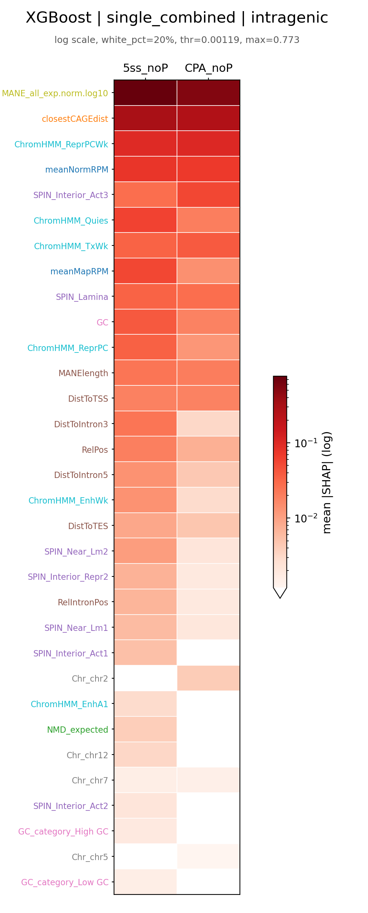](figures/cls_baseline_logshap_intragenic.png)

[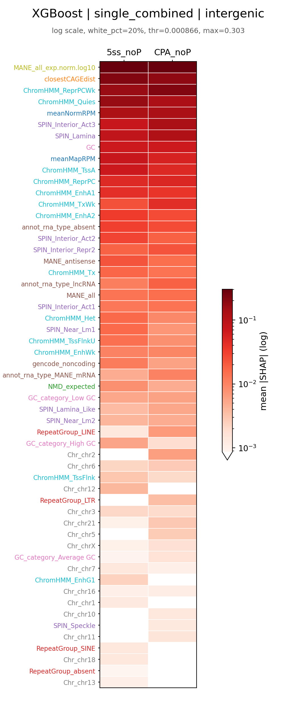](figures/cls_baseline_logshap_intergenic.png)

*Click a figure to open it at full resolution.*

 
<h3><ins>Click to expand: same figures without host gene expression</ins></h3>

Host gene expression is the strongest single feature, so it was removed and everything
retrained, to see what the rest of the context can do on its own.

**Model quality. Left: intragenic. Right: intergenic.**

<a href="figures/cls_nohostexp_metrics_intragenic.png">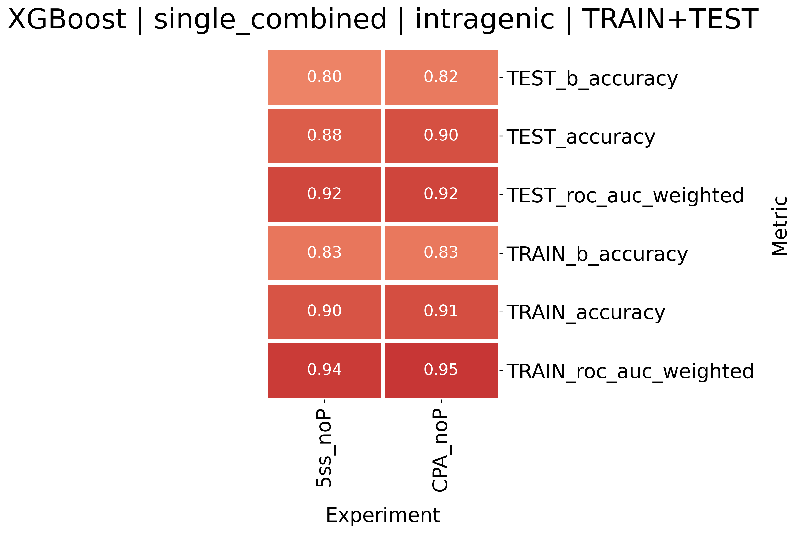</a>
<a href="figures/cls_nohostexp_metrics_intergenic.png">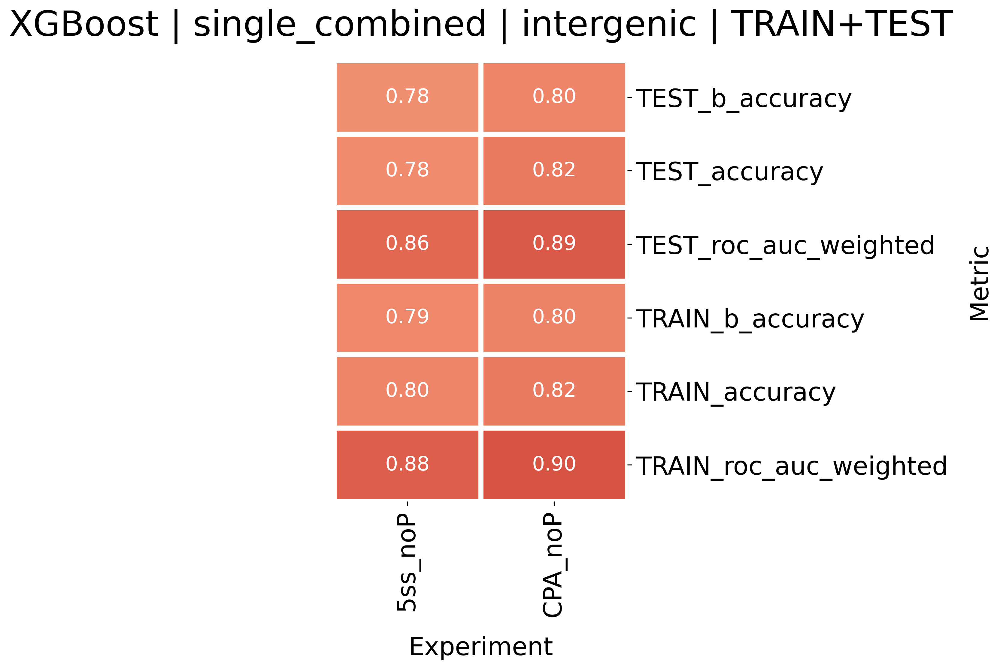</a>

**Feature importance. Top: intragenic. Bottom: intergenic.**

**Feature importance, log colour scale. Top: intragenic. Bottom: intergenic.**

[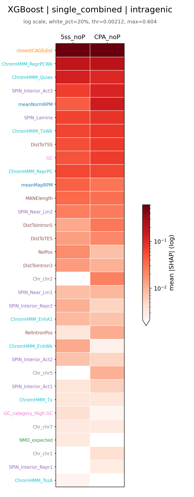](figures/cls_nohostexp_logshap_intragenic.png)

[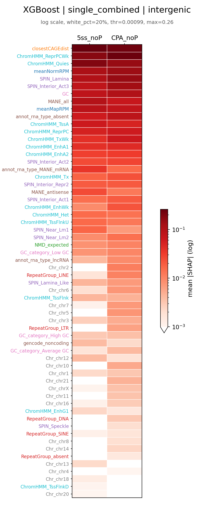](figures/cls_nohostexp_logshap_intergenic.png)

*Click a figure to open it at full resolution.*

Removing a feature that
carried 45% of the total contribution costs only about 0.015 of ROC-AUC. The information
did not disappear, it was picked up by other features. Distance to the nearest CAGE
cluster roughly doubles its share, from about 18% to about 38%.

---

## 2. Regression: how strongly is the reporter expressed?

Target is `log10(1 + meanRPM)`. The log matters. Raw `meanRPM` runs from 0 to about
40,000 while the median is below 1, and roughly a third of barcodes are exactly zero. On
raw values a single barcode accounts for more than half of the total variance and the
hundred largest account for about 94%.

The model was barely trained on raw `meanRPM`

### Model quality

**Left: intragenic. Right: intergenic.**

<a href="figures/reg_baseline_metrics_intragenic.png">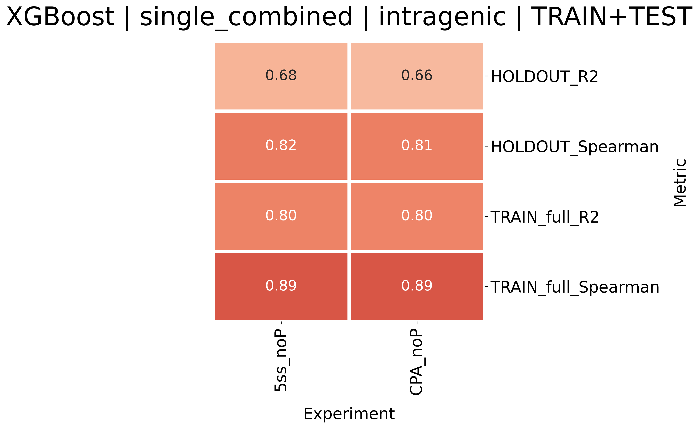</a>
<a href="figures/reg_baseline_metrics_intergenic.png">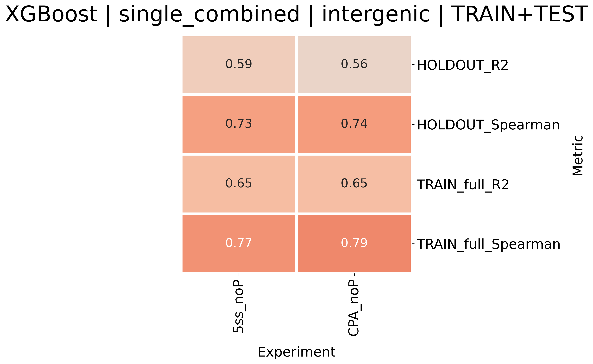</a>

*Click a figure to open it at full resolution.*

### Feature importance

**Top: intragenic. Bottom: intergenic.**

[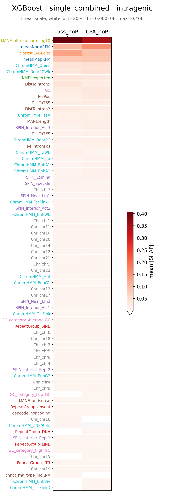](figures/reg_baseline_shap_intragenic.png)

[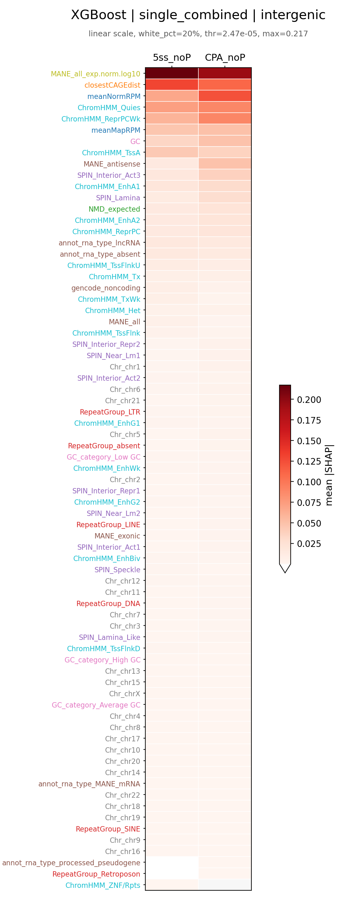](figures/reg_baseline_shap_intergenic.png)

*Click a figure to open it at full resolution.*

Compared with the classifier on exactly the same features, the regression model has about 71 non-zero columns against about 35.

In the regression intragenic model the NMD flag
reaches about 3% and sits around 7th place. In the classifier it is near the bottom, about
0.2% and around 24th.

### Feature importance, log colour scale

**Top: intragenic. Bottom: intergenic.**

*Click a figure to open it at full resolution.*

<h3><ins>Click to expand: same figures without host gene expression</ins></h3>

**Model quality. Left: intragenic. Right: intergenic.**

<a href="figures/reg_nohostexp_metrics_intragenic.png">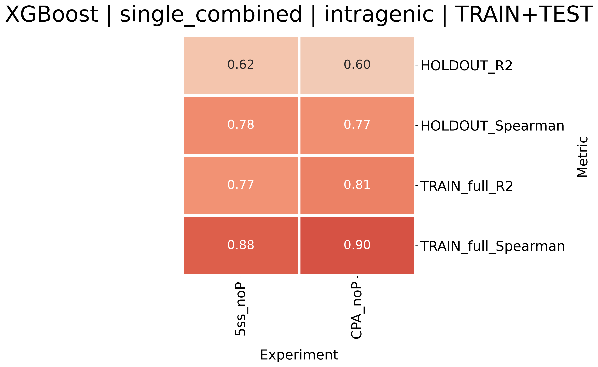</a>
<a href="figures/reg_nohostexp_metrics_intergenic.png">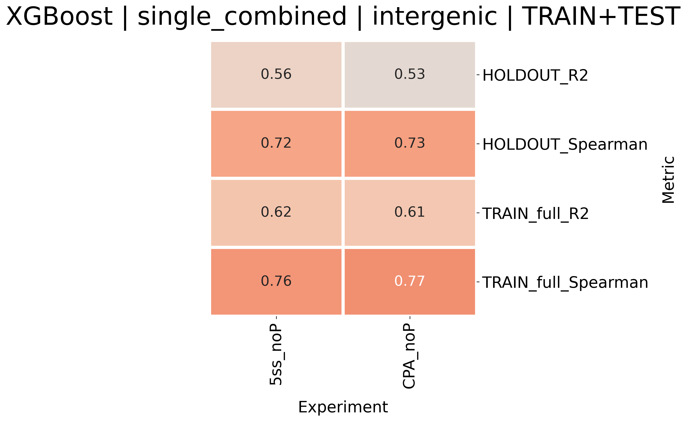</a>

**Feature importance. Top: intragenic. Bottom: intergenic.**

[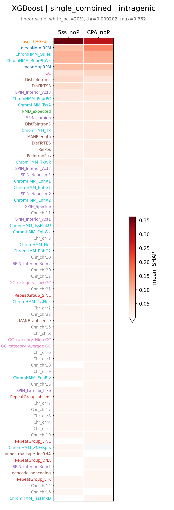](figures/reg_nohostexp_shap_intragenic.png)

**Feature importance, log colour scale. Top: intragenic. Bottom: intergenic.**

[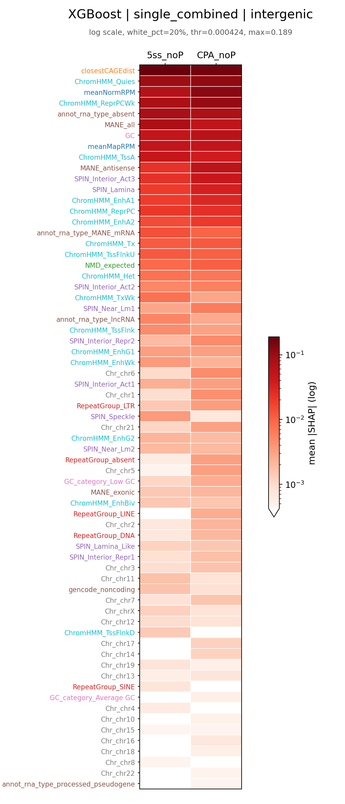](figures/reg_nohostexp_logshap_intergenic.png)

*Click a figure to open it at full resolution.*

Removing host gene expression costs more here than in the classification task, roughly
0.05 of R2 against roughly 0.015 of ROC-AUC.

