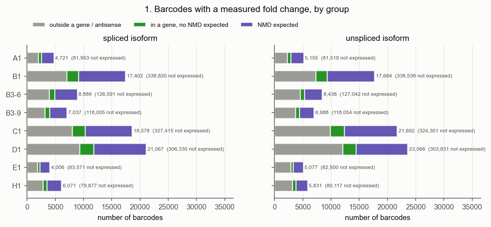
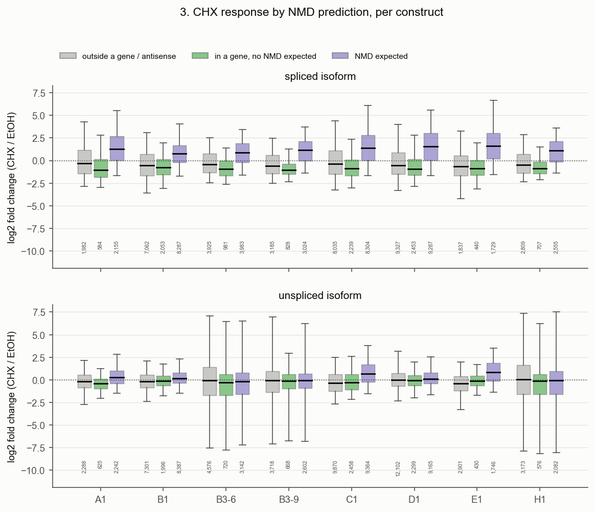
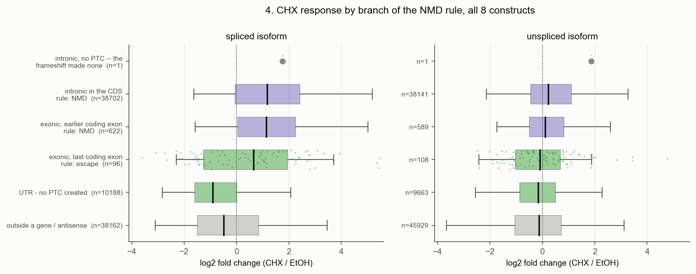
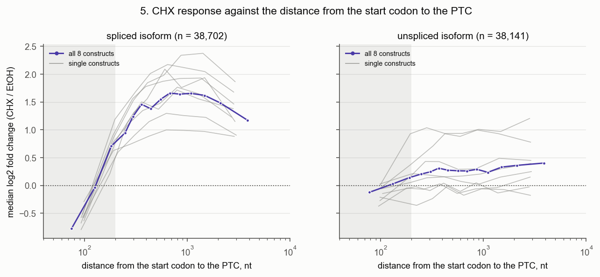
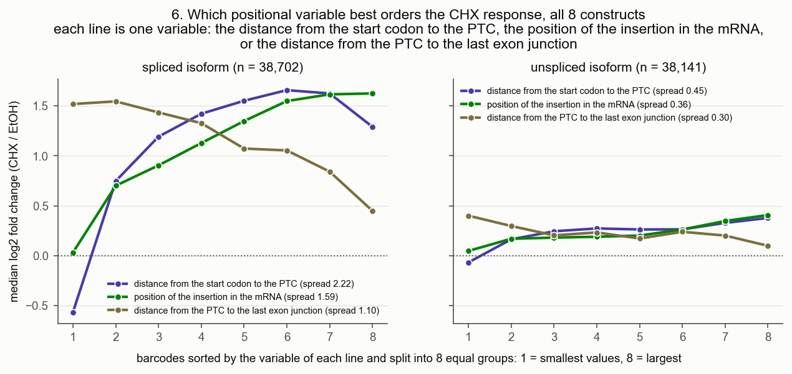
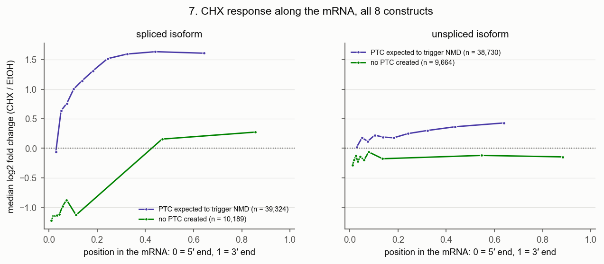
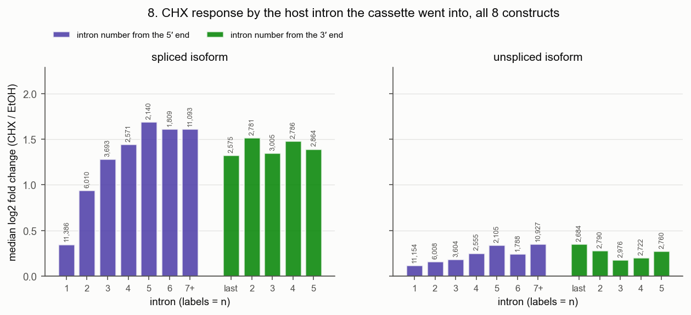
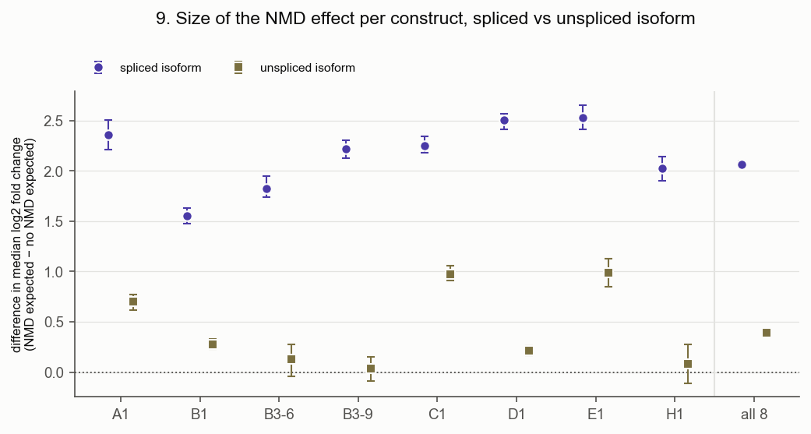
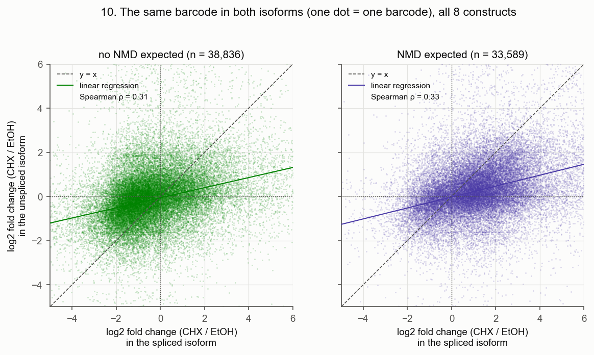
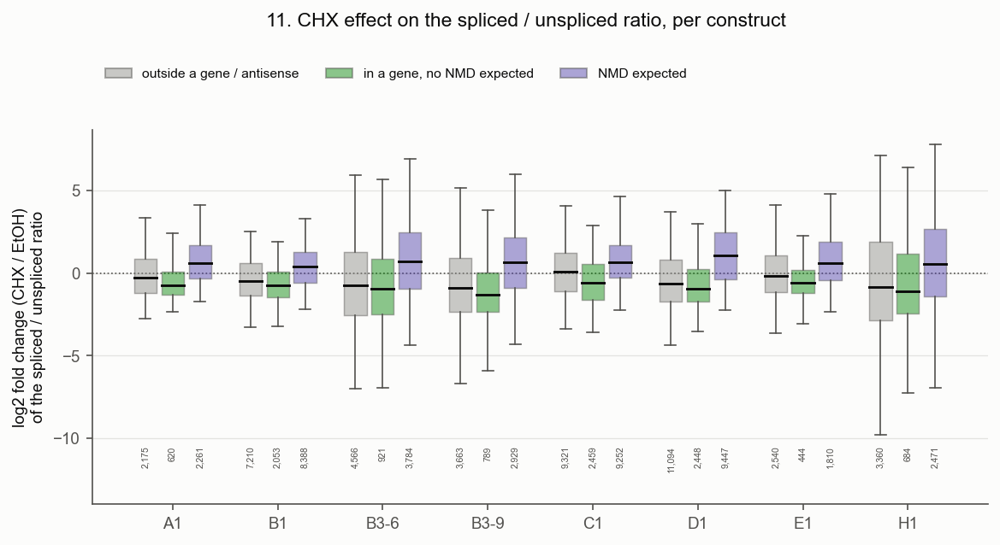

# 1

Each construct gives 4–24k barcodes with a fold change, and a bit over 40% of them are predicted NMD targets.

# 3

As Igor mentioned the spliced form is more strongly affected by NMD because some of the unspliced RNA remains in the nucleus and is therefore not subject to NMD. For introns that are almost completely spliced out, NMD has little to no effect.

Predicted NMD targets go up with CHX in the spliced isoform of all 8 constructs.

# 4

Insertions the rule calls NMD (CDS introns, earlier coding exons) go up. UTR insertions stay below baseline. The last-coding-exon group also goes up, but it is only 96 barcodes.

# 5

PTCs close to the start codon escape NMD: no effect below ~150 nt, then a sharp rise that plateaus by ~500 nt. Same AUG-proximity effect as in 5ss/CPA.

# 6

Distance from the ATG predicts the response better than insertion position or distance to the last junction, as in 5ss/CPA.

# 7

Along the whole mRNA, barcodes with an NMD-triggering PTC stay well above those without one.

How it was made: barcodes from all 8 constructs pooled, only insertions in a gene on the same strand. The x axis is where the insertion sits in the mature mRNA, as a fraction of its length (0 = 5′ end, 1 = 3′ end). For an intronic insertion this is the exon junction the cassette is spliced into. Violet: insertions predicted to create a PTC that triggers NMD. Green: insertions that create no PTC (UTR insertions). Each group is sorted by position and cut into 10 bins with equal numbers of barcodes, and each point is the median position and the median log2 fold change (CHX / EtOH) of one bin.

# 8

Insertions into the first intron respond least, in line with the ATG-proximity effect. Counted from the 3′ end, there is no trend.

# 9

The NMD effect is +1.6 to +2.5 in the spliced isoform everywhere. In the unspliced isoform it is 0.7–1.0 in A1, C1 and E1, 0.2–0.3 in B1 and D1, and zero in B3-6, B3-9 and H1.

# 10

For the same barcodes, NMD targets go up in the spliced isoform but hardly in the unspliced one.

# 11

CHX raises the spliced/unspliced ratio of predicted NMD targets in all 8 constructs.
