# NMD prediction vs the measured CHX response — short version


The figures below are committed in `analysis/pics/`. To redraw them you need matplotlib and the two
output tables the pipeline produces, which are not in this repository:

```bash
python3 analysis/make_figures.py      # reads output/nmd_table_*.tsv, writes analysis/pics/
```

---

## 1. The model

A reporter cassette lands somewhere in the genome. Whether the host transcript becomes an NMD
target depends on where it landed, and the two cases are completely different.

### The rule both models are judged by

> **A premature stop more than 50 nt upstream of the last junction BETWEEN CODING EXONS triggers NMD.
> Closer than that, or past it, the transcript escapes.**

"Coding exons" are exons 1 … *k*, where exon *k* is the one holding the host's own normal stop codon.
So the junction that counts is the one joining the last two coding exons — not the last junction of
the transcript:

```
mRNA   ═exon 1═│═exon 2═│ … │═exon k-1═│═══ exon k, holds the STOP ═══│═ 3'UTR exon ═
                                       ↑                              ↑
                              this junction counts            this one does not
```


### Model 1 — insertion into an intron

The cassette's two arms are themselves introns, so they leave together with the host intron. What
is left in the mature mRNA is a new 400-nt exon spliced in flush between two host exons:

```
genome    ═══ host exon ═══──┤ host intron [ 5' arm ] EXON [ 3' arm ] host intron ├──═══ host exon ═══
                             └──── spliced out ──────┘    └──── spliced out ─────┘

mRNA      ═══ host exon ═══│[ 75 nt arm ][ 325 nt globin exon ]│═══ host exon ═══
                           ↑            400 nt inserted        ↑
                        junction                            junction
```

One host junction becomes two. 400 is not a multiple of 3, so everything below the insert is read
out of frame. This case is **unambiguous, so we compute it**: build the modified mRNA, find the
first in-frame stop, measure the distance to the last junction.

### Model 2 — insertion into an exon

The cassette splits a host exon in half, and there is no splice site between host exon sequence and
the piggyBac repeat. What the spliceosome does next cannot be worked out from coordinates:

```
before    ═══════════════ host exon ═══════════════

after     ═══ left half ═══[ 5' arm ]EXON[ 3' arm ]═══ right half ═══
                           ↑ acceptor        ↑ donor
                    the whole thing may stay, or a half may be skipped
```

So we **do not compute** these; we classify them by a rule:

| where in the transcript | verdict |
|---|---|
| any UTR, 5' or 3' | no NMD — no premature stop is created at all |
| last coding exon (the one holding the stop codon) | no NMD — translation already ends there |
| any earlier coding exon | NMD |

The same UTR rule is applied to intronic insertions too, and it is checked **first**: if the
insertion sits in a UTR, we never even ask exon-or-intron.

---

## 2. What is in the libraries

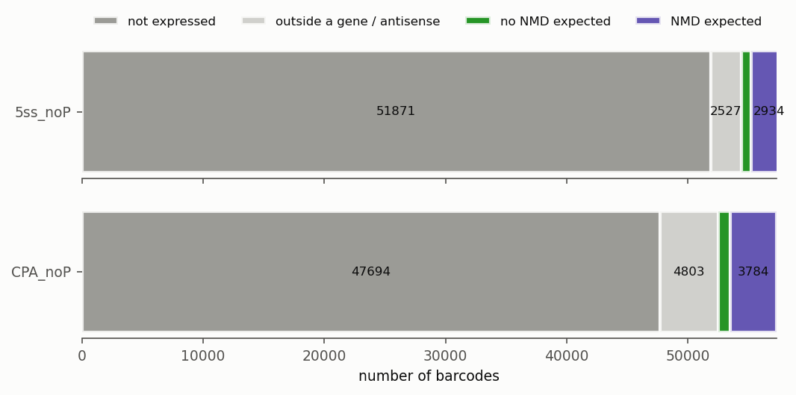

**5ss_noP — 58 172 barcodes**

| group | n | share |
|---|---|---|
| 1 — not expressed | 51 871 | 89.2% |
| 2 — outside a gene, or antisense to it | 2 527 | 4.3% |
| 3 — in a gene, no NMD expected | 840 | 1.4% |
| 4 — in a gene, NMD expected | 2 934 | 5.0% |

**CPA_noP — 57 303 barcodes**

| group | n | share |
|---|---|---|
| 1 — not expressed | 47 694 | 83.2% |
| 2 — outside a gene, or antisense to it | 4 803 | 8.4% |
| 3 — in a gene, no NMD expected | 1 022 | 1.8% |
| 4 — in a gene, NMD expected | 3 784 | 6.6% |

Almost everything is category 1: the barcode has no fold change because it never reached the read
threshold. Everything below is computed on what is left — 6 301 barcodes in 5ss and 9 609 in CPA.

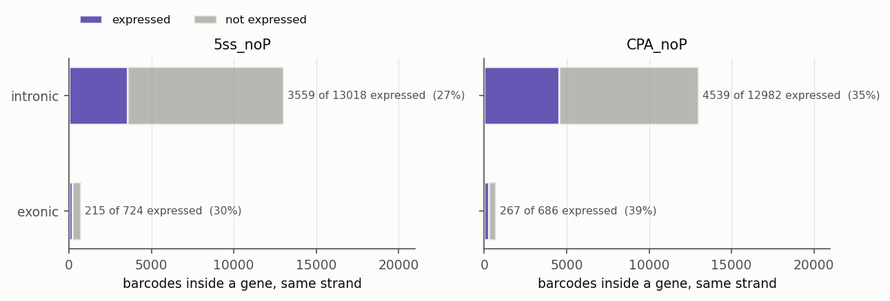

How the in-gene barcodes split between introns and exons, with the expressed share of each.

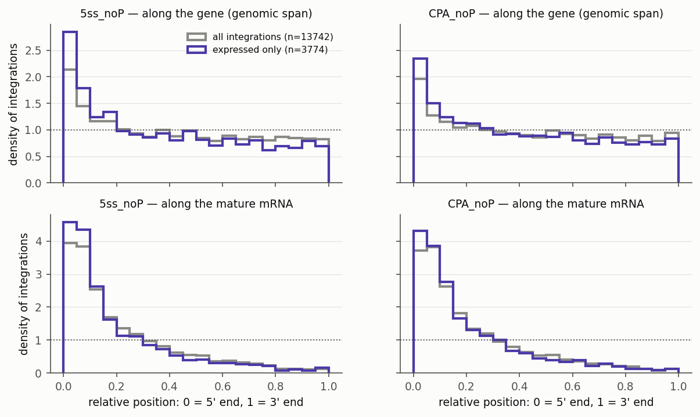

Where the integrations sit, with every gene rescaled to 0…1 so genes of different length and exon
count can be pooled. Top row: position along the gene as it lies in the genome. Bottom row: position
along the mature mRNA — for an intronic hit that is the junction the cassette splices into, since the
intron itself is not in the mRNA. Grey is all in-gene barcodes, violet only the expressed ones; the
dotted line at 1.0 is what a uniform landscape would look like.


## 3. Is the readout an artifact?


The obvious worry is that we are just reading out something about the reporter, not about NMD. Two
checks.

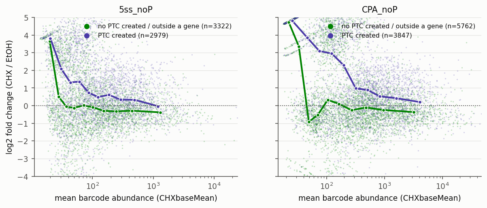

**CHXbaseMean is how abundant the barcode is**. DESeq2 computes it as the
mean read count of that barcode across all four samples (2× CHX, 2× EtOH) after correcting for
sequencing depth. Median is 93, i.e. a typical barcode has ~93 reads per sample.

Fold changes at low counts are noisy and biased upward. And indeed at the left
edge both groups shoot up — that region cannot be trusted. What matters is that the violet line
(a premature stop was created) sits **above** the green one across the whole range, including the
well-covered barcodes on the right. So the separation is not an accident of coverage.

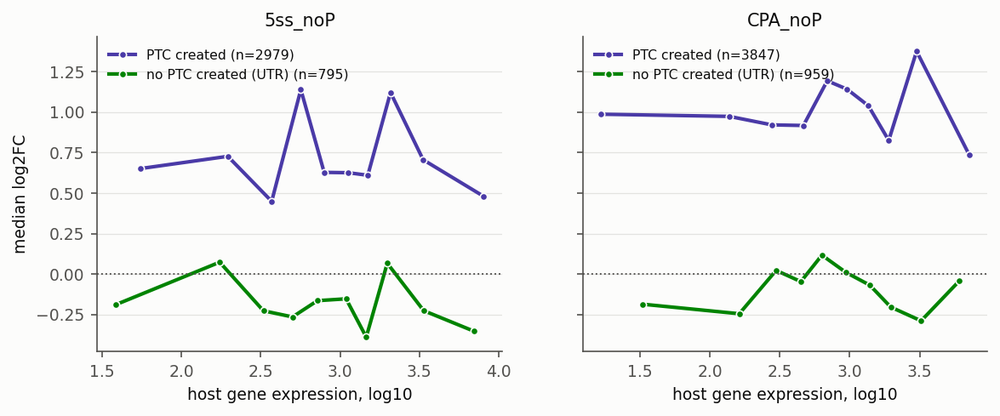

The same for the host gene. The two lines run **parallel** across the whole range, with a constant
gap of about 0.8–1.1. How active the host gene is does not change the answer.

---

## 4. Where the premature stop comes from

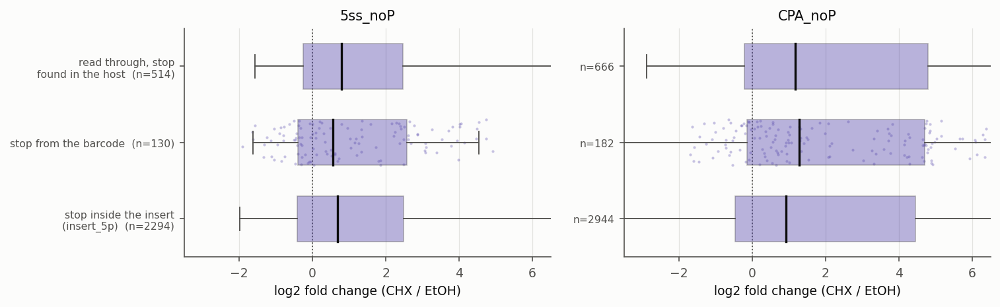


Sanity check: it does not matter which codon became the stop, only that one
appeared. If we were mis-identifying stops, these would not agree.

---

## 5. Main result — the prediction separates the data

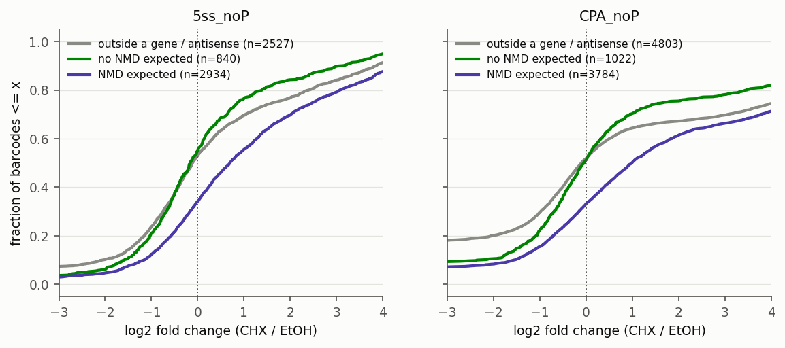


The violet curve (NMD expected) is shifted right along its whole length. The green one (in a gene,
no NMD expected) lies almost exactly on the grey baseline of barcodes outside genes. So landing
inside a gene does nothing by itself; what does something is the predicted premature stop.


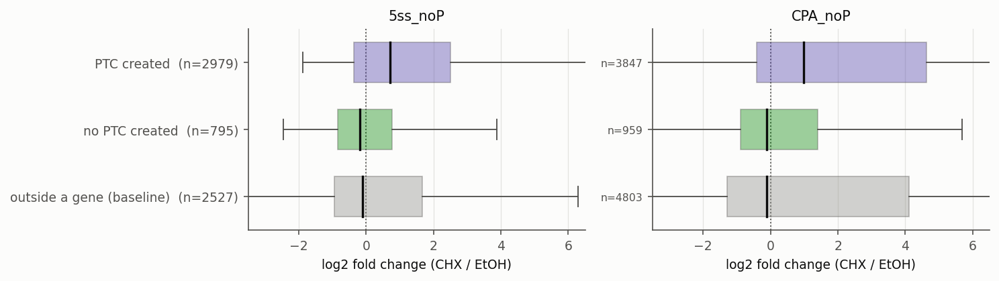

The coarsest and cleanest split. The external baseline and "no stop created" land on top of each
other; "a stop was created" moves up. Medians: category 4 at **+0.70 / +0.99** against category 3
at **−0.16 / −0.05** and the out-of-gene baseline at **−0.11 / −0.11**.

Read only the difference between groups, never the absolute value: the median over all expressed
barcodes is +0.22 / +0.29, because CHX lifts everything.

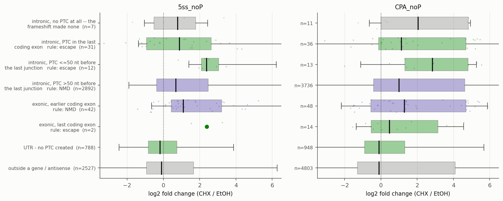

The same barcodes grouped by which branch of the rule decided them. A group with fewer than 5
barcodes is drawn as a bare median dot.


---

## 6. Positional effect

Something we never put into the rule showed up on its own.

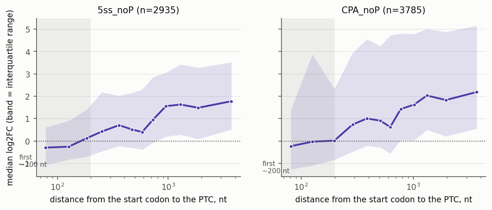

The x axis is how far the ribosome travels from the start codon before it hits the premature stop.
This is not a gradual trend — it is a **step at about 200 nt**:

| nt from ATG to the stop | 5ss | CPA |
|---|---|---|
| 0–100 | **−0.23** | **−0.23** |
| 100–200 | **−0.17** | −0.03 |
| 200–400 | +0.55 | +0.63 |
| 400–800 | +0.65 | +0.93 |
| 800–1600 | +1.50 | +1.77 |
| 1600–3200 | +1.71 | +1.97 |
| 3200+ | +1.46 | +2.09 |


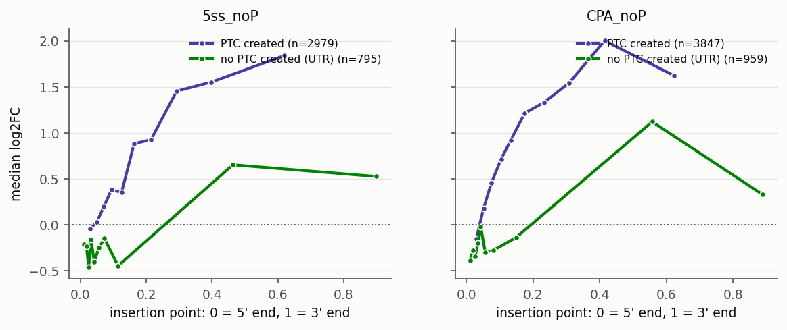

The same effect on a relative axis: both groups climb towards the 3' end, and the one with a
premature stop stays above the one without it the whole way.

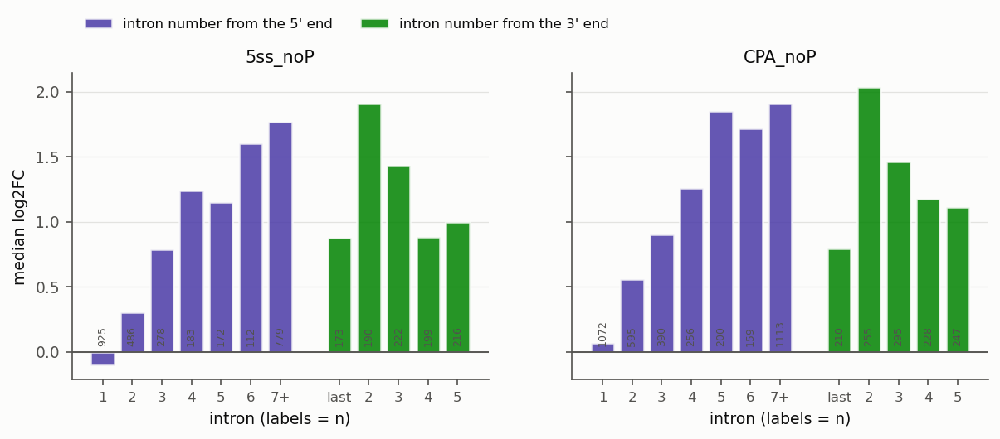

The same thing counted discretely, by which intron the insertion landed in — numbered from the 5' end
and, separately, from the 3' end.

### Which measurement predicts best

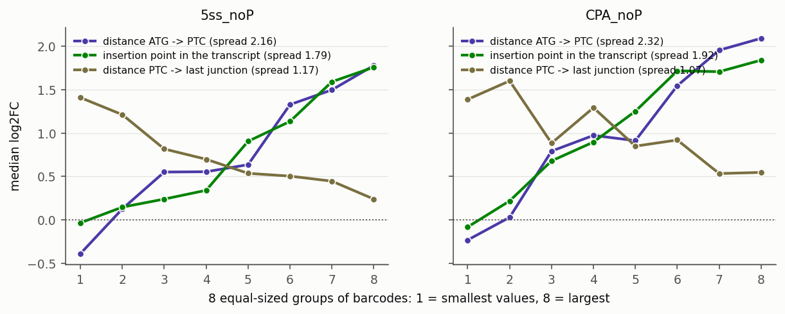

Take all barcodes with a computed stop, sort them by one variable, cut the sorted list
into **8 equal-sized groups**, and take the median response in each. Group 1 holds the smallest
values, group 8 the largest. Each line is those 8 medians.


Bin contents for 5ss_noP (368 barcodes per group):

| group | distance ATG → stop | median | insertion point | median | distance stop → last junction | median |
|---|---|---|---|---|---|---|
| 1 | 27–126 nt | **−0.38** | 0.005–0.045 | −0.04 | −522–446 nt | +1.40 |
| 2 | 126–222 | +0.13 | 0.045–0.071 | +0.14 | 449–682 | +1.21 |
| 3 | 222–360 | +0.55 | 0.071–0.101 | +0.23 | 682–955 | +0.82 |
| 4 | 360–525 | +0.62 | 0.101–0.142 | +0.35 | 955–1263 | +0.72 |
| 5 | 528–735 | +0.62 | 0.143–0.201 | +0.91 | 1263–1716 | +0.52 |
| 6 | 735–1110 | +1.33 | 0.201–0.291 | +1.15 | 1717–2301 | +0.52 |
| 7 | 1113–1872 | +1.50 | 0.291–0.435 | +1.59 | 2304–3490 | +0.48 |
| 8 | 1872–22224 | **+1.77** | 0.435–0.959 | +1.75 | 3492–24178 | +0.23 |
| | **spread 2.15** | | **spread 1.79** | | **spread 1.17** | |

And for CPA_noP (474–475 barcodes per group):

| group | distance ATG → stop | median | insertion point | median | distance stop → last junction | median |
|---|---|---|---|---|---|---|
| 1 | 27–126 nt | **−0.23** | 0.005–0.046 | −0.08 | −522–462 nt | +1.38 |
| 2 | 126–237 | +0.03 | 0.046–0.075 | +0.24 | 463–712 | +1.71 |
| 3 | 237–390 | +0.81 | 0.075–0.110 | +0.68 | 712–979 | +0.89 |
| 4 | 390–561 | +0.96 | 0.110–0.151 | +0.91 | 979–1281 | +1.27 |
| 5 | 564–777 | +0.90 | 0.151–0.216 | +1.25 | 1281–1685 | +0.86 |
| 6 | 780–1158 | +1.61 | 0.216–0.305 | +1.76 | 1687–2295 | +0.91 |
| 7 | 1158–1965 | +2.00 | 0.306–0.449 | +1.71 | 2295–3485 | +0.54 |
| 8 | 1968–22335 | **+2.04** | 0.449–0.949 | +1.84 | 3490–23387 | +0.54 |
| | **spread 2.27** | | **spread 1.92** | | **spread 1.17** | |

That downward line is not evidence that the rule is wrong. The distance to the last junction is not an independent measurement here: the premature stop almost always appears 23–54 nt into the insert, so the distance is essentially "how much transcript lies below the insertion point" — it correlates +0.998 with exactly that. It is a position in disguise.

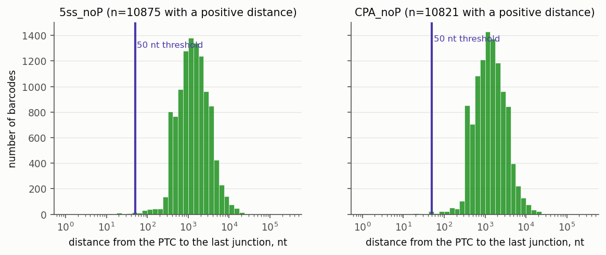

The threshold itself sits far to the left of the whole data mass — the 5th percentile of the distance
is 343 nt — which is why it changes the verdict for only 30 rows in 5ss and 33 in CPA.

---

## 7. Chromatin

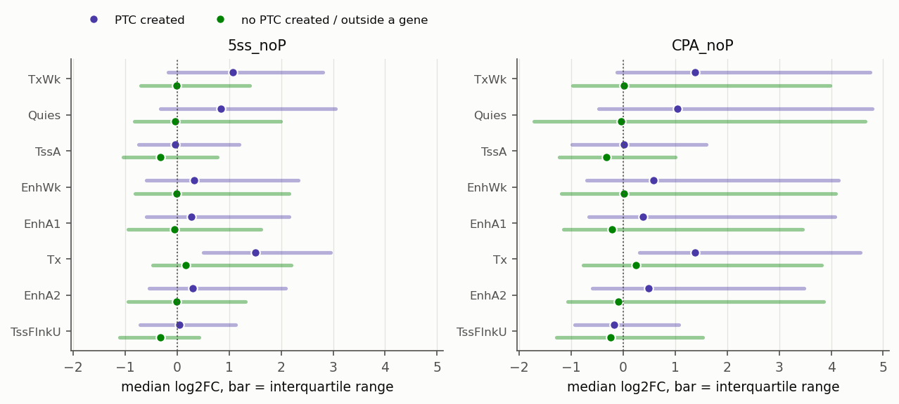

The same comparison split by ChromHMM state: the group with a premature stop sits above the one
without it in every state and in both libraries, so the effect is not a by-product of the chromatin
the reporter happened to land in.

---

## 8. Both libraries agree

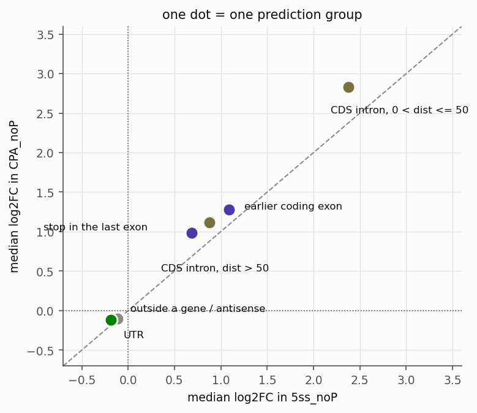

Each dot is one prediction group, its median in 5ss against its median in CPA: the baseline groups sit
at zero and the stop-bearing ones far above it, in the same order in both libraries.

